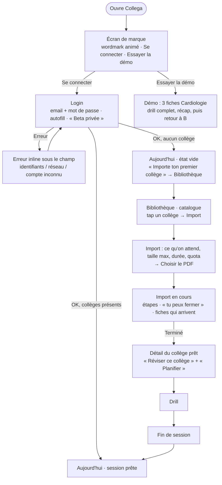
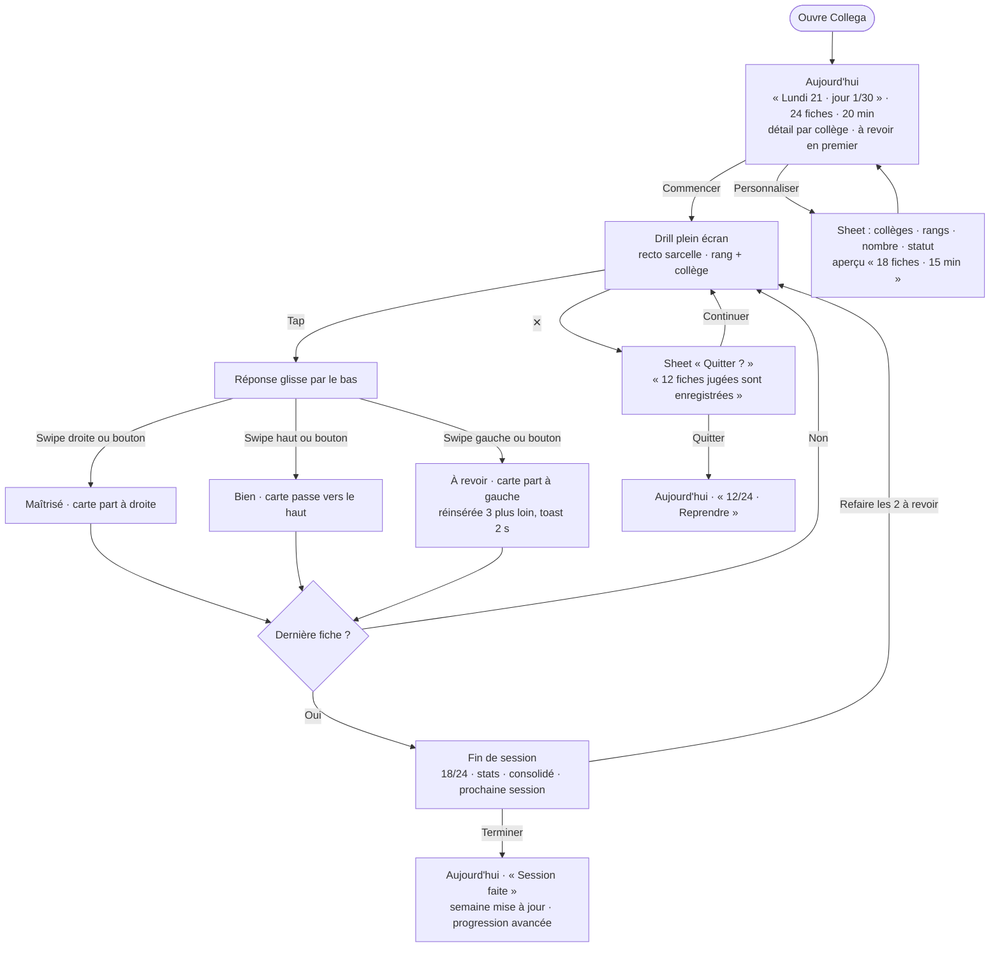
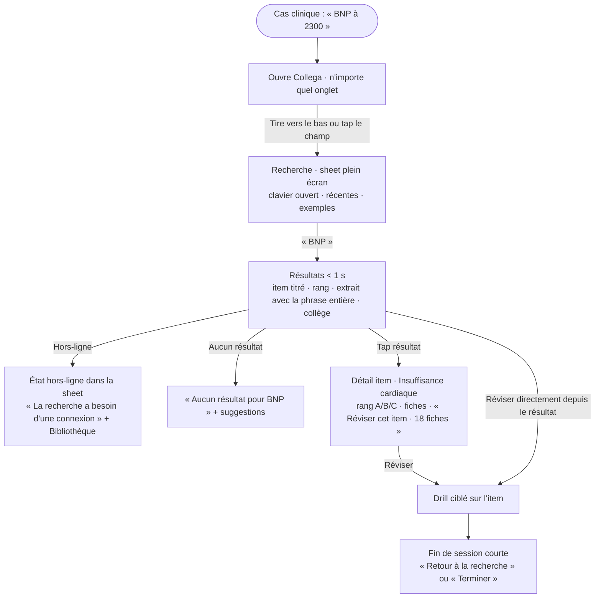
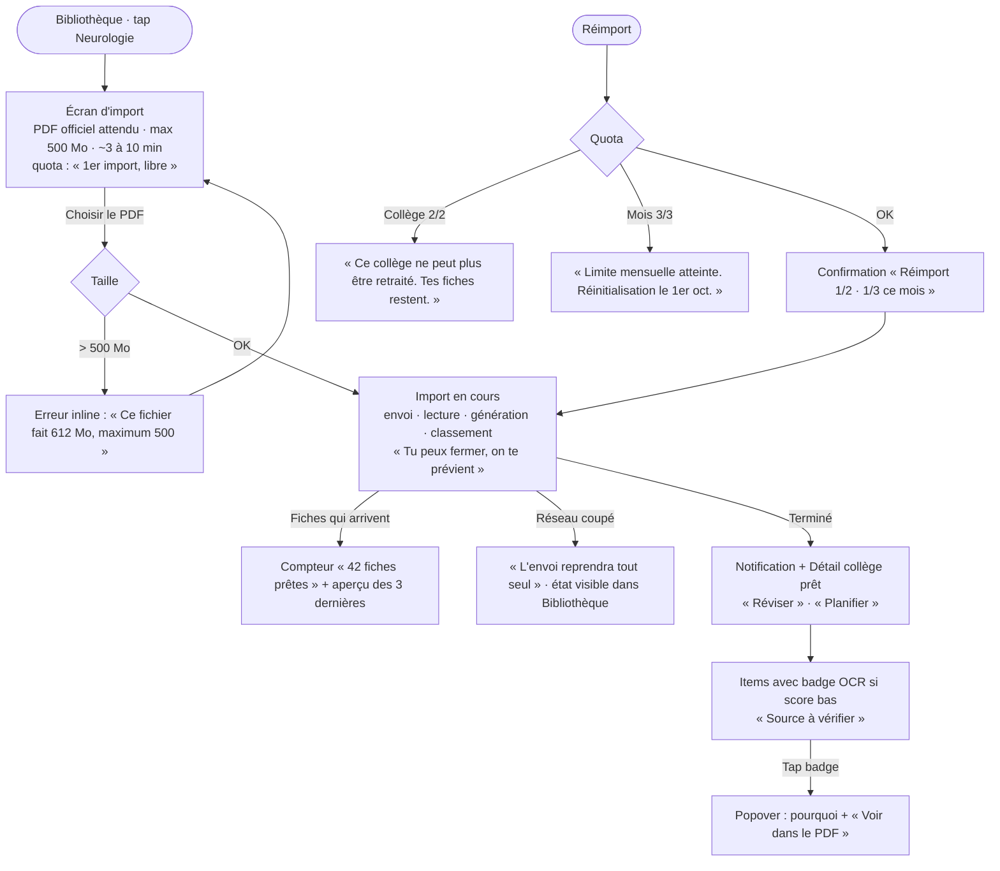

# UX Design Specification v2 — Collega

**Auteur :** Lesurmatthis
**Date :** 2026-09-21
**Remplace :** la spec UX v1 du 2026-04-26 (conservée comme référence)

---

## Cadrage (session du 2026-09-21)

Décisions prises avant cette spec, qui la contraignent :

| Sujet | Décision |
|---|---|
| Ambition | Re-imagination complète (navigation, Home, modèle de session ouverts) — cible App Store, testée d'abord par les beta-testeurs invités |
| Nom | **Collega** partout ; « AppMédecine » disparaît |
| À garder (fond) | Hero « session du jour », drill 3 niveaux avec réinsertion, fonction planning (restylée), démo (derrière le login) |
| Navigation | 4 onglets **Aujourd'hui · Bibliothèque · Progression · Profil** ; recherche = action globale en overlay |
| Inscription | Retirée. Login seul + mention « Beta privée · accès sur invitation » ; comptes créés à la main |
| Entrée | Écran de marque → « Se connecter » (principal) / « Essayer la démo » (secondaire) |
| Identité | Palette et typographie ouvertes ; un seul thème (celui de la direction retenue) ; pas d'emoji ; SVG animé ; pas de hover |
| Wahou | Mouvement + typographie/espace + progression rendue visible ; matière/profondeur en secondaire |
| Références | Things 3 / Linear / Arc · Apple Fitness / Santé / Oura |
| Drill | Tap pour retourner ; swipe gauche = à revoir, droite = maîtrisé, haut = bien ; 3 boutons toujours présents |
| Stack | shadcn_ui négociable selon la direction ; flutter_animate conservé ; iPhone uniquement |
| Périmètre | Tous les écrans, paywall et CGU inclus |
| **Prérequis story 0** | **Tout item a un titre, obligatoirement** (génération backend + migration des collèges déjà importés) — première story de l'implémentation, avant le thème |

## Résumé exécutif

### Vision du projet

Collega transforme les PDF officiels des collèges médicaux en fiches de révision par item et par rang, et propose chaque jour la session qui correspond au cursus réel de l'étudiant. La v1 a prouvé que le pipeline fonctionne (import → OCR → génération → drill, 177 fiches en 3 minutes). La v2 doit prouver que l'app donne envie d'y revenir : elle doit se placer, visuellement et en usage, à côté de Things 3 et d'Apple Fitness — pas à côté d'un template Material.

### Utilisateurs cibles

| Persona | Moment | Ce que la v2 lui doit |
|---|---|---|
| Léa (révision, 60 %) | Ouvre l'app le soir, 20-30 min | Sa session prête, sa progression visible, zéro décision |
| Tom (stage, 40 %) | Couloir d'hôpital, une main, 2 min | Recherche en un geste, résultat lisible, drill en un tap |
| Camille (PDF dégradé) | Première fiche douteuse | Un badge qui informe sans alarmer |
| Beta-testeur invité | Première ouverture | Comprendre sans explication ; « wow » à l'écran 1 |

Tous sur iPhone, une seule main fréquente (stage), usage court et répété. Familiers d'Anki (modèle À revoir / Bien / Maîtrisé) et des apps iOS soignées.

### Défis UX clés

1. **Remplacer un rendu Material par un système iOS propre** sans casser ce qui marche (drill, hero, planning) — neuf composants natifs Material à retirer.
2. **Donner une maison à la progression** : une seule grammaire (par collège, par rang, dans la semaine) avec l'onglet Progression, là où la v1 en avait quatre sans légende.
3. **Dessiner les états** : vide, chargement, erreur, hors-ligne sur 13 écrans — aujourd'hui `e.toString()` et écrans blancs.
4. **Rendre la recherche utilisable** : extrait contextuel, titre d'item, un seul CTA — condition du mode stage.
5. **Tenir le « minimaliste + wahou »** : mouvement et typographie sans hover, sans emoji, sans ornement ; la retenue est la difficulté.

### Opportunités de design

1. **L'onglet Progression** comme signature (anneaux par collège, semaine, planning vivant) — ce qu'Anki n'a jamais rendu beau et ce que Fitness fait bien.
2. **Le drill comme moment de mouvement** : swipe avec prévisualisation du verdict, sortie de carte physique, compteur qui avance — 60 % de l'usage, donc 60 % du wahou.
3. **La fin de session comme récompense** : score, prochaine session, points forts / à consolider — le pic de la Peak-end rule, inexistant en v1.
4. **L'entrée de marque** : wordmark SVG animé, login sobre, démo en second — le premier « wow » coûte un écran.
5. **Prérequis exploité** : chaque item ayant un titre, la Bibliothèque et la recherche peuvent enfin parler le langage de l'étudiant (« Tumeurs du testicule », pas « Item 310 »).

## Expérience cœur

### L'expérience définissante

> « J'ouvre Collega, ma session du jour est prête. Je la fais. Je vois ce que j'ai gagné. »

La boucle quotidienne est **une seule session mixte** calculée par le planning : les fiches « à revoir » de tous les collèges du planning d'abord, puis les nouvelles par rang A → B → C, jusqu'à la durée disponible du jour. Un seul bouton. La session est marquée faite automatiquement à la dernière fiche — l'étudiant ne déclare jamais à l'app ce qu'elle sait déjà.

Second chemin, le **mode stage** : depuis n'importe quel écran, un geste ouvre la recherche ; un résultat mène à l'item ; l'item lance un drill ciblé. Trois taps, une main.

### Stratégie plateforme

- iPhone uniquement (iOS 16+), portrait, tactile. iPad hors périmètre v2.
- Usage à une main fréquent (couloir de stage) : toute action primaire dans le tiers inférieur de l'écran ; la recherche s'ouvre depuis le bas, pas depuis un champ en haut.
- Offline garanti pour la révision : Aujourd'hui, drill, Bibliothèque et Progression fonctionnent sans réseau (fiches et progression locales) ; seuls la recherche plein-texte, l'import et la synchro exigent le réseau, et le disent.
- Capacités exploitées : haptique (évaluation, retournement, fin de session), Dynamic Type, safe areas, gestes natifs (retour par balayage, sheets), autofill Trousseau / Face ID au login, notifications (fiches prêtes, rappel).

### Interactions sans effort

| Geste | Ce qui doit être vrai |
|---|---|
| Lancer la session | Un tap depuis Aujourd'hui, sans choix préalable |
| Évaluer une fiche | Swipe gauche (à revoir) / droite (maîtrisé) / haut (bien) ou 3 boutons ; retour haptique ; la carte part dans le sens du verdict |
| Retourner une fiche | Tap sur la carte, invite visible tant que l'étudiant n'a pas retourné sa première fiche |
| Finir une session | Automatique ; le récap apparaît, le planning avance, Aujourd'hui se met à jour |
| Chercher | Depuis tout écran, une main, suggestions avant de taper, résultats lisibles sans ouvrir |
| Voir où j'en suis | Sans navigation : Aujourd'hui (jour, session), Progression (collèges, rangs, semaine) |
| Importer | Un choix de fichier ; l'app dit ce qu'elle attend, combien de temps, et continue en arrière-plan |

Ce qui se passe seul : calcul et recalcul du planning, marquage de session, synchro des fiches, reprise d'upload, mise à jour de la progression.

### Moments critiques

| Moment | Réussite | Échec = expérience ruinée |
|---|---|---|
| Écran 1 (marque + login) | « C'est une vraie app » | Formulaire nu, nom inconnu |
| Premier import → première session | Fiches titrées, session proposée dès la fin | Atterrir sur un catalogue de 40 |
| 10e fiche du drill | Le geste est devenu réflexe | Chercher le bouton, perdre la question |
| Fin de session | Un score, une prochaine date, un progrès visible | Un écran de 4 boutons |
| Recherche « BNP » en stage | L'item et l'extrait en < 1 s, drill en un tap | Le mot seul surligné |
| Erreur ou hors-ligne | « Tes fiches sont là » + quoi faire | `e.toString()` |

### Principes d'expérience

1. **Zéro décision pour réviser** — la session est proposée, calculée, mixte, auto-clôturée.
2. **Où j'en suis, sans chercher** — une seule grammaire de progression, visible sur Aujourd'hui et Progression.
3. **Le geste avant le bouton** — swipe, tap, balayage retour ; les boutons restent pour l'accessibilité, jamais seuls.
4. **Chaque écran a ses quatre états** — vide, chargement, erreur, hors-ligne dessinés avant d'être codés ; l'erreur rassure d'abord.
5. **iOS d'abord** — composants et gestes natifs par défaut ; tout ce qui ressemble à Material est un bug.
6. **La retenue comme style** — une couleur d'accent, une typographie qui porte, un mouvement par écran, pas de hover, pas d'emoji.

## Réponse émotionnelle

### Émotion cible

**La maîtrise tranquille.** L'étudiant sent que l'app tient son programme à sa place et qu'il progresse sur ce qui compte — sans être stimulé, félicité ou culpabilisé. Le sentiment que doit produire Collega est celui de Things 3 : « c'est sous contrôle », pas celui de Duolingo : « reviens vite ». Ce qu'il racontera à un ami : « elle a fait mes fiches, elle me dit quoi réviser, et c'est beau ».

### Parcours émotionnel

| Moment | Émotion visée | Ce qui la produit |
|---|---|---|
| Écran 1 | Curiosité, sérieux | Wordmark animé, login sobre, rien à lire |
| Premier import | Confiance pendant l'attente | L'app dit ce qu'elle fait, combien de temps, qu'on peut partir ; les premières fiches apparaissent avant la fin |
| Session du jour | Concentration | Drill plein écran, un geste, un mouvement, aucune distraction |
| Fin de session | Satisfaction nette, brève | Score animé, progression qui bouge, prochaine session datée ; une seule action principale |
| Progression | Fierté calme | Anneaux et barres qui reflètent des semaines de travail, sans classement ni streak punitif |
| Erreur / hors-ligne | Rassuré | « Tes fiches sont là » d'abord, puis la cause, puis l'action |
| Retour le lendemain | Évidence | Aujourd'hui a déjà tout préparé ; rien à rouvrir, rien à configurer |

### Micro-émotions critiques

- **Confiance** plutôt que scepticisme — chaque fiche montre son rang et, si besoin, son badge de qualité OCR ; les titres d'items parlent médecine.
- **Accomplissement** plutôt que frustration — la fin de session est un pic (Peak-end rule), pas un formulaire.
- **Calme** plutôt qu'excitation — pas de confettis, pas de streak rouge, pas de notification pressante ; le mouvement souligne, il ne réclame pas.
- **Contrôle** plutôt qu'obéissance — la session est proposée, pas imposée : personnaliser et décaler restent à un tap, sans pénalité.

### Émotions à éviter

| Émotion | Déclencheur v1 | Réponse v2 |
|---|---|---|
| Anxiété | « 0 % maîtrisé · 0 fiches » à l'ouverture d'un collège | Progression relative à ce qui a été vu ; un collège neuf dit « 177 fiches à découvrir » |
| Confusion | Cinq styles de sélecteur, erreurs techniques | Un système de composants, des erreurs écrites pour l'étudiant |
| Culpabilité | Session manquée, planning en retard | Ton neutre, recalcul silencieux, jamais de compteur de jours ratés |
| Infantilisation | Emojis, exclamations, mascotte | Aucun emoji, aucune exclamation, illustrations SVG abstraites |
| Défiance | Nom qui change, écrans dépareillés | Collega partout, une seule identité |

### Ton de voix

Tutoiement sobre. Phrases courtes, factuelles, au présent. Pas d'exclamation, pas de superlatif, pas d'humour forcé. Le chiffre avant l'adjectif : « 24 fiches · 20 min » plutôt que « Une belle session t'attend ». Les erreurs suivent l'ordre rassurer → expliquer → proposer. Exemples : « Ta session est prête », « Tes fiches sont là. La recherche a besoin d'une connexion. », « Session terminée — 18 maîtrisées, 4 à revoir. Prochaine session demain. »

## Analyse UX et inspiration

### Produits inspirants (look et sensation)

**Things 3** — la référence pour « Aujourd'hui ». Une liste par jour, un titre, des éléments qui se cochent avec une animation courte et un son discret. Ce qui se transfère : la vue « Aujourd'hui » comme écran d'accueil, le grand titre qui est aussi la date, l'espace blanc qui n'est jamais vide (il sépare), les gestes (balayage, glisser) avant les boutons, le récap « tout est fait » qui vide l'écran plutôt qu'il ne le remplit.

**Linear** — la typographie comme structure. Une seule famille, trois graisses, des chiffres tabulaires, des lignes plutôt que des cartes, une couleur d'accent rare. Ce qui se transfère : la hiérarchie par la taille et la graisse plutôt que par des cadres ; les listes denses et lisibles (Bibliothèque) ; le raccourci clavier devenu ici geste (recherche globale, façon Cmd-K → tirer vers le bas).

**Arc** — l'espace comme matière et le mouvement comme signature. Ce qui se transfère : une palette qui appartient à l'utilisateur (accent unique mais vivant), les transitions qui relient les écrans (l'élément tapé devient l'écran suivant), l'onboarding en un écran de marque.

**Apple Fitness / Santé / Oura** — la donnée personnelle rendue belle. Ce qui se transfère : l'anneau comme unité de progression (un par collège, fermé = maîtrisé), le résumé en haut puis le détail, la semaine comme horizon visible, les tendances sans jugement (Oura ne gronde jamais), la couleur qui code une seule chose (l'état) et ne décore pas.

### Comparables (fonction)

| Produit | Ce qu'il fait bien | Ce qu'on refuse |
|---|---|---|
| **Anki** | Modèle À revoir / Bien / Maîtrisé installé, réinsertion intra-session | Interface, configuration, aucune notion de rang, planning à la charge de l'étudiant |
| **Duolingo** | Une leçon par jour proposée, boucle courte, fin de leçon célébrée | Mascotte, streaks anxiogènes, gamification, ton exclamatif |
| **Quizlet** | Modes d'étude sur le même deck, swipe de flashcards, aperçu avant de lancer | Publicités, densité, decks partagés génériques |
| **Brainscape** | Confiance 1-5 comme évaluation, répétition dosée, statistiques par deck | Visuel daté, couleurs saturées, upsell permanent |

### Patterns transférables

**Navigation**
- Tab bar iOS 4 onglets, la recherche hors des onglets (Things : recherche par geste ; Arc : Cmd-T).
- Écran d'accueil = « Aujourd'hui » daté (Things), résumé en haut, détail en dessous (Fitness).
- Transitions liées : la carte de collège s'ouvre en écran de collège, la fiche du récap s'ouvre en fiche (Arc, iOS).

**Interaction**
- Swipe de carte avec prévisualisation du verdict pendant le drag (Quizlet, Tinder-like), boutons en secours (accessibilité).
- Cocher / évaluer avec haptique et animation courte (Things).
- Tirer vers le bas depuis le haut d'une liste pour chercher (iOS Spotlight, Things).

**Visuel**
- Anneaux de progression par collège + barre segmentée par rang (Fitness + spec v1).
- Une famille typographique, chiffres tabulaires, grands nombres en display (Linear, Fitness).
- Fin de session = écran plein, un chiffre, une courbe, une action (Fitness « Résumé de l'entraînement »).
- Illustrations SVG abstraites, animées à l'arrivée, pour les états vides (pas de mascotte, pas d'emoji).

### Anti-patterns à éviter

- **Material sur iOS** — pilule de nav, ripple, FAB, snackbars, AppBar teintée.
- **Gamification punitive** — streaks, badges, classement, notifications pressantes (Duolingo, Brainscape).
- **Tout en cartes** — cinq cartes blanches identiques empilées (Profil v1) ; la hiérarchie vient de la typographie et des listes (Linear, iOS).
- **Le vide accidentel** — 55 % d'écran vide sous une carte (drill v1) ; l'espace est composé ou il est rempli.
- **L'ornement IA** — dégradés violet-bleu, emojis en puces, cartes à bord coloré partout, ombres sur tout, hover sur mobile.
- **La configuration avant la valeur** — planning à remplir avant de voir quoi que ce soit (Anki, planning v1).

### Stratégie d'inspiration

**Adopter** : la vue « Aujourd'hui » de Things, l'anneau de Fitness, le swipe de Quizlet, le modèle 3 niveaux d'Anki.
**Adapter** : la typographie-structure de Linear au contenu médical (titres d'items, rangs, chiffres) ; les transitions liées d'Arc au duo collège → item → fiche ; le récap d'entraînement de Fitness en récap de session.
**Éviter** : tout ce qui réclame (streak, mascotte, exclamation), tout ce qui décore (dégradé, emoji, carte), tout ce qui vient de Material.

## Fondation du design system

### Choix : système maison « Collega UI »

Un design system propriétaire, léger, dans `collega_app/lib/core/ui/` : des **tokens** (couleur, typographie, espace, rayon, durée, courbe) et **quatorze composants** construits sur les primitives Flutter (`Container`, `CustomPaint`, `GestureDetector`, `Sliver*`) et sur Cupertino pour ce qui doit rester natif (date picker, switch, sheet modale, retour par balayage, haptique). `flutter_animate` porte le mouvement, `flutter_svg` les illustrations et le wordmark.

`shadcn_ui` reste une dépendance le temps de la migration écran par écran, puis est retiré. Aucun widget Material visible ne subsiste ; `MaterialApp` peut rester comme conteneur technique (routing, overlays) avec un thème neutralisé.

### Rationale

- **Identité** : l'objectif « à côté de Things 3 » exige des composants dessinés pour Collega, pas thémés depuis un port de shadcn.
- **iOS d'abord** : Cupertino fournit exactement les briques natives que les étudiants reconnaissent (pickers, switch, sheets) et rien d'autre ; le reste est à nous.
- **Taille tenable** : quatorze composants couvrent les seize écrans ; c'est moins de code que le thème shadcn + ses correctifs (`progressTheme`, rail `secondary`).
- **Testabilité** : chaque composant a une entrée Widgetbook et un golden test ; les écrans ne font qu'assembler.
- **Pas de piège de défaut** : aucune couleur n'est héritée d'un thème tiers ; tout passe par nos tokens.

### Les quatorze composants

| Composant | Rôle | Écrans |
|---|---|---|
| `CgButton` (primary / secondary / quiet / destructive) | Toute action | Tous |
| `CgTabBar` | Navigation 4 onglets, safe area, haptique | Shell |
| `CgHeader` | Large title + date/contexte + action optionnelle | Aujourd'hui, Bibliothèque, Progression, Profil |
| `CgListRow` + `CgListGroup` | Lignes et groupes insetGrouped (collèges, items, réglages) | Bibliothèque, Profil, Planning |
| `CgSegmented` | Sélecteur 2-4 valeurs (filtres, rangs) | Bibliothèque, Détail collège, Sheet session |
| `CgSheet` | Sheet modale native (personnaliser, confirmer, recherche) | Aujourd'hui, Recherche, Détail item |
| `CgDrillCard` | Carte recto/verso, retournement, swipe avec verdict | Drill, Démo |
| `CgVerdictBar` | 3 boutons d'évaluation + retours haptiques | Drill |
| `CgRing` | Anneau de progression (collège, session) | Progression, Fin de session, Aujourd'hui |
| `CgRankBar` | Barre segmentée Maîtrisé / Bien / À revoir / Non vues | Progression, Détail collège, Détail item |
| `CgBadge` (rang A/B/C, OCR, beta) | Étiquette sémantique | Tous |
| `CgField` | Champ de saisie (login, définition, feedback) | Login, Drill, Détail item |
| `CgState` (empty / error / offline) | État vide, erreur, hors-ligne avec illustration SVG et action | Tous |
| `CgSkeleton` + `CgToast` | Chargement et notification légère | Tous |

### Stratégie de personnalisation

- **Tokens** définis à l'étape « Fondation visuelle » et figés par la direction visuelle retenue : une couleur d'accent, des neutres teintés, une famille typographique (à choisir, Inter exclu par défaut), une échelle 8 pt, deux rayons, trois durées de mouvement.
- **Cupertino** n'est jamais thémé au-delà de la couleur d'accent : ses widgets restent reconnaissables comme natifs.
- **Mouvement** : chaque composant a au plus une animation (entrée, verdict, fermeture) ; les transitions d'écran sont définies une fois dans le routeur.
- **Illustrations** : SVG monochromes sur le token d'accent, animées à l'apparition avec `flutter_animate` ; pas d'emoji, pas de raster.

## Expérience définissante

### L'interaction signature

> **Retourner, juger, voir la carte partir.**

Collega se raconte en une phrase : « tu ouvres, ta session est là, tu swipes tes fiches ». Si la fiche de drill est parfaite — lisible, réactive, physique — tout le reste (planning, progression, recherche) prend sa valeur. Si elle est médiocre, rien ne rattrape.

### Modèle mental de l'étudiant

Il arrive avec Anki : recto → réflexion → verso → « je savais / à peu près / pas du tout ». Il arrive aussi avec Tinder et Quizlet : une carte se swipe et part dans un sens. Collega superpose les deux sans en inventer un troisième :
- **tap** = retourner (Anki, Quizlet) ;
- **swipe droite** = maîtrisé, **swipe gauche** = à revoir (convention oui/non universelle) ;
- **swipe haut** = bien (la carte « passe » sans être écartée) ; les trois boutons doublent les trois swipes pour l'accessibilité et pour ceux qui ne swipent pas.

Confusion probable : swiper le recto avant de l'avoir retourné. Réponse : le recto ne se swipe pas ; il résiste (élastique, 8 pt) et l'invite « Touche pour voir la réponse » se renforce. Impossible d'évaluer sans avoir vu.

### Critères de succès

- Le retournement démarre sous le doigt en < 50 ms, dure 300 ms, sans saccade sur une fiche de 600 caractères.
- Pendant le swipe, le verdict est prévisualisé (teinte + libellé « Maîtrisé » / « À revoir » / « Bien ») dès 40 pt de déplacement ; relâcher avant le seuil (35 % de la largeur, ou 25 % de la hauteur vers le haut) ramène la carte. La direction dominante (horizontale ou verticale) est verrouillée après 12 pt.
- Le verdict est confirmé par un haptique distinct (succès léger / impact moyen), la carte sort dans le sens du swipe en 250 ms, la suivante monte depuis la pile en même temps.
- Le compteur et la barre de session avancent avec la sortie de carte, pas après.
- La question reste visible au verso (bandeau en haut de carte).
- Une fiche « à revoir » réinsérée l'annonce en 2 s sans bloquer (toast bas).
- À la dernière carte, le récap apparaît sans tap.

### Établi vs nouveau

**Établi (adopter sans friction)** : recto/verso, trois verdicts, réinsertion des « à revoir », swipe gauche / droite / haut (Quizlet, Tinder).

**Nouveau (à rendre évident sans tutoriel)** :
- Le **rang** sur la carte (A/B/C) comme information permanente, pas comme filtre.
- Le **mode définition** (l'étudiant écrit sa réponse, l'app la compare) : même carte, mais le verso ne s'ouvre qu'après saisie ; le champ vit dans la carte, pas sous elle.
- La **session mixte** : la carte annonce son collège en discret (label sous le rang) pour que le changement de matière ne surprenne pas.

### Mécanique de l'expérience

| Étape | Ce qui se passe | Signal |
|---|---|---|
| Initiation | Tap « Commencer » sur Aujourd'hui ; le drill s'ouvre plein écran, tab bar masquée | Transition depuis la hero, première carte monte de la pile |
| Lecture | Recto centré, texte à la taille de lecture, rang + collège en label | Invite de retournement (première session seulement, puis disparaît) |
| Retournement | Tap → flip 3D 300 ms ; verso = bandeau question + réponse | Haptique léger |
| Jugement | Swipe gauche (à revoir) / droite (maîtrisé) / haut (bien) avec prévisualisation, ou les trois boutons | Teinte + libellé sous le doigt |
| Confirmation | Carte sort, suivante arrive, compteur avance | Haptique de verdict, barre de session |
| Réinsertion | « À revoir » → la carte revient 3 positions plus loin, une fois | Toast 2 s « Elle reviendra dans quelques questions » |
| Complétion | Dernière carte partie → récap : anneau qui se ferme, chiffres qui montent, prochaine session | Haptique de succès, une action principale |
| Interruption | ✕ ou balayage retour → sheet « Quitter ? 12 fiches jugées sont enregistrées » | Rien n'est perdu, la session reprend là où elle est |

## Fondation visuelle

### Principe

La fondation est un contrat de tokens sémantiques. Les directions visuelles (étape suivante) en proposent chacune une instanciation ; la direction retenue fixe les valeurs. Aucun écran, aucun composant ne référence une couleur, une taille ou une durée brute.

### Système de couleurs — rôles

| Rôle | Usage | Contrainte |
|---|---|---|
| `ground` | Fond d'écran | Neutre teinté vers l'accent (jamais #FFF ni #000 purs) |
| `surface` | Cartes, sheets, tab bar | Un cran au-dessus de `ground` ; pas d'ombre par défaut |
| `ink` / `ink2` / `ink3` | Texte principal / secondaire / désactivé | ≥ 7:1 · ≥ 4.5:1 · ≥ 3:1 sur `ground` |
| `line` | Séparateurs, contours | Visible sans dominer (≈ 1.3:1) |
| `accent` | Une seule couleur de marque : CTA primaire, sélection, wordmark, anneau plein | ≥ 4.5:1 avec `ground` en texte, ≥ 3:1 en surface ; jamais utilisée pour décorer |
| `accent-soft` | Fond de sélection, surlignage de recherche | Dérivée de `accent` |
| `rank-a` / `rank-b` / `rank-c` | Rangs A/B/C | Trois valeurs distinguables sans couleur (forme + lettre) ; A le plus contrasté |
| `state-mastered` / `state-good` / `state-review` / `state-unseen` | Verdicts et segments de progression | Séquence lisible en daltonisme (luminance croissante) ; `state-review` ≠ `danger` |
| `danger` | Destructif, erreur bloquante | Réservé : supprimer, erreur ; jamais « à revoir », jamais déconnexion |
| `warning` | Badge OCR à vérifier | Distinct de `state-review` |

Règle d'or : **un accent**. Le vert v1 utilisait une couleur pour dix rôles ; la v2 en donne une à chaque rôle et une seule à la marque. Si une direction garde le vert, il devient `accent` et rien d'autre.

Thème : un seul (celui de la direction retenue). Les tokens sont nommés pour qu'un second thème soit un second fichier, pas une réécriture.

### Système typographique

Une seule famille, choisie par la direction — **Instrument Sans**, arrêtée à la section « Direction de design ». Candidats écartés, ni Inter ni Roboto ni SF (le brief refuse le « défaut ») : grotesque contemporaine (Geist, Instrument Sans, Söhne-like, Manrope), humaniste (Source Sans 3, Public Sans), ou géométrique tempérée (Outfit, Plus Jakarta). Chiffres tabulaires obligatoires (progression, compteurs).

| Rôle | Taille / graisse | Usage |
|---|---|---|
| `display` | 40 / 700, -2 % | Grand nombre (« 24 fiches »), score de session |
| `title-l` | 32 / 700 | Large title des onglets, date |
| `title` | 22 / 600 | Titre de section, nom de collège |
| `head` | 17 / 600 | Titre de ligne, question de fiche (recto court) |
| `body` | 17 / 400, 1.45 | Réponse de fiche, contenu |
| `body-s` | 15 / 400 | Métadonnées, sous-titres de ligne |
| `label` | 13 / 500, +2 %, capitales optionnelles | Badges, rangs, compteurs |
| `mono` (optionnel) | 13 | Numéros d'items, chiffres de progression |

Dynamic Type respecté : tout est en `sp` relatif au réglage iOS, avec plafond sur `display` et `title-l`.

### Espace, formes, mouvement

- **Grille 8 pt** ; gouttière écran 20 pt (HIG), gouttière interne de ligne 16 pt.
- **Rythme vertical** : 8 entre éléments liés, 16 entre lignes, 32 entre sections, 48 avant un large title.
- **Rayons** : deux valeurs — `r-s` 10 pt (champs, badges, boutons), `r-l` 20 pt (cartes de drill, sheets). Rien d'autre.
- **Élévation** : aucune ombre par défaut ; une seule ombre douce autorisée sur la carte de drill en mouvement et sur les sheets.
- **Mouvement** : trois durées — `fast` 150 ms (retours haptiques visuels), `base` 250 ms (verdict, transitions de liste), `slow` 400 ms (flip, fermeture d'anneau) ; une courbe de sortie (ease-out) et une courbe élastique (retour de carte). `prefers-reduced-motion` iOS → durées à 0, flip remplacé par fondu.
- **Tap target** ≥ 44 × 44 pt ; zone d'action primaire dans le tiers inférieur.

### Layout

Colonne unique, largeur d'écran, safe areas respectées. Large title qui se réduit au scroll (comportement iOS). Contenu principal en listes et en lignes ; les cartes sont réservées à ce qui se manipule (fiche de drill, hero de session). Un seul bouton primaire par écran, ancré en bas quand l'écran a une action.

### Accessibilité

Contrastes du tableau des rôles vérifiés à la génération des tokens (test automatique). Aucune information portée par la couleur seule : rangs = lettre, verdicts = libellé + position, badge OCR = icône + texte. VoiceOver : labels sur tous les composants Collega UI. Haptique désactivable (Réglages iOS respectés).

## Direction de design

### Exploration

Trois directions ont été maquettées en HTML interactif (6 écrans chacune, drill jouable) et comparées sur l'iPhone le 2026-09-21 — `_bmad-output/planning-artifacts/directions-v2/` :

| Direction | Lignée | Fond / accent | Police | Ce qui a plu | Ce qui a été écarté |
|---|---|---|---|---|---|
| A — Feuille | Things 3 / Linear | Papier gris chaud / cobalt | Instrument Sans | **Toute la mise en page** (Aujourd'hui, Bibliothèque, Détail collège, bas de Fin de session, Progression) ; le côté minimaliste | Le cobalt, trop froid |
| B — Nuit | Apple Fitness / Oura | Nuit bleutée / glacier, anneaux | Geist | Rien de décisif | Thème sombre unique, panneaux en cartes |
| C — Bloc | Arc / éditorial | Pierre / sarcelle en surfaces pleines | Bricolage Grotesque | **La palette**, la page de couleur du drill, le haut de Fin de session, la grande barre de Progression | La bascule 3D de l'écran entier, la grotesque large |

### Décision : « Feuille × Bloc »

Maquette de référence : `directions-v2/direction-d-fusion.html`.

- **Structure** : celle de Feuille — large title, listes à filets, cartes réservées à ce qu'on manipule, capsule flottante iOS 26 claire.
- **Palette** : celle de Bloc — `ground` pierre `#ECEAE3`, `surface` `#F7F6F2`, `ink` `#17201F`, `ink2` `#454D4C`, `ink3` `#60645E` (ajustés en 8.15 : tout texte ≥ 4,5:1), `line` `#D9D6CC`, `accent` sarcelle `#0E5E63`, `accent-soft` `#D5E6E4` ; états `mastered` `#0E5E63`, `good` `#6FA8A2`, `review` `#D9822B`, `unseen` `#D9D6CC` ; `danger` `#B8352B`. Le sarcelle est l'héritier assombri du vert v1 : la continuité de marque est conservée, l'usage devient rare.
- **Typographie** : Instrument Sans, seule famille, chiffres tabulaires. Échelle de la Fondation visuelle.
- **Drill** : écran entier sarcelle (la « page de couleur ») ; au tap, la question remonte en bandeau et **la réponse glisse par le bas** sur une feuille pierre (variante 2a) ; swipe gauche/droite avec prévisualisation du verdict, trois boutons dans la feuille. Pas de rotation 3D.
- **Fin de session** : haut en bloc sarcelle (score `18/24` qui s'incrémente, barre blanche), bas Feuille (stats à filets, consolidé, prochaine session, un bouton primaire).
- **Progression** : grande barre segmentée en tête (`31 %` en large title), puis semaine, anneaux par collège, rangs, planning en listes.

### Ce que la direction fixe pour les tokens

| Token | Valeur |
|---|---|
| `ground` / `surface` / `soft` | `#ECEAE3` / `#F7F6F2` / `#E2E0D8` |
| `ink` / `ink2` / `ink3` / `line` | `#17201F` / `#454D4C` / `#60645E` / `#D9D6CC` |
| `accent` / `accent-soft` / `accent-ink` | `#0E5E63` / `#D5E6E4` / `#F2F5F3` |
| `rank-a` / `rank-b` / `rank-c` | `#0E5E63` / `#4C6A6E` / `#8B8A80` |
| `state-mastered` / `good` / `review` / `unseen` | `#0E5E63` / `#6FA8A2` / `#D9822B` / `#D9D6CC` |
| `danger` / `warning` | `#B8352B` / `#D9822B` |
| Police | Instrument Sans (Google Fonts, `google_fonts`) |
| Rayons | `r-s` 10 pt, `r-l` 20 pt ; boutons 14 pt |
| Tab bar | Capsule flottante, `surface` à 90 % + flou (libellés inactifs ≥ 4,5:1, 8.15), 64 pt, 24 pt des bords |

Contrastes à vérifier à la génération des tokens : `ink` sur `ground` ≈ 13:1, `ink2` sur `ground` ≈ 5.4:1, `accent` sur `ground` ≈ 6.2:1, `accent-ink` sur `accent` ≈ 6.9:1, `review` sur `ground` ≈ 3.1:1 (réservé aux surfaces et aux textes ≥ 18 pt ; en texte courant, utiliser `#9A5A16`).

## Parcours utilisateur

### Parcours 1 — Première ouverture (beta-testeur invité → première session)



**Ce qui change par rapport à la v1** : login en premier, pas d'inscription ; l'état vide d'Aujourd'hui mène à l'import ; la fin d'import atterrit sur le collège prêt (pas sur le catalogue) et propose immédiatement de réviser ou de planifier.

### Parcours 2 — La session du jour (Léa, 60 % de l'usage)



**Règles** : la session est marquée faite à la dernière fiche, jamais par un bouton ; quitter n'efface rien et Aujourd'hui propose « Reprendre » ; le planning se recalcule silencieusement le lendemain si la session n'a pas été finie (pas de compteur de retard). Trois gestes, trois directions : gauche = à revoir, haut = bien, droite = maîtrisé ; les boutons les doublent.

### Parcours 3 — Mode stage (Tom, 40 %)



**Règles** : un seul CTA par résultat (le titre est le lien ; « Réviser » en action secondaire) ; l'extrait montre la phrase complète avec le terme surligné ; la sheet garde la dernière recherche.

### Parcours 4 — Import, attente, qualité (Léa puis Camille)



**Règles** : l'écran d'import dit tout avant le choix de fichier ; l'attente montre les fiches au fil de l'eau ; toute erreur commence par « tes fiches restent ».

### Parcours 5 — Planifier (depuis Progression ou Aujourd'hui)

```mermaid
flowchart TD
    A([Progression · Planning]) --> B[Planning\ncollèges (importés cochés par défaut) · période · minutes/jour]
    B --> C[Aperçu vivant\n« 341 fiches · 30 jours · ~12 par jour · faisable »]
    C -->|Trop court| C2[« 341 fiches en 10 jours = 34 par jour, ~45 min » — ajuster ou accepter]
    C -->|Enregistrer| D[Progression · calendrier de la période\njours faits / à venir · aujourd'hui]
    D --> E[Aujourd'hui reflète le jour 1]
```

**Règles** : l'aperçu se recalcule à chaque changement, avant tout enregistrement ; le planning est visible après coup (Progression) ; « Décaler aujourd'hui » existe sans pénalité.

### Patterns communs aux parcours

- **Entrée par le bas** : action primaire ancrée en bas ; recherche par tirer-vers-le-bas ou champ ; sheets pour tout ce qui est modal (personnaliser, quitter, confirmer).
- **Retour** : balayage iOS partout ; le drill et l'import en cours sont des écrans pleins sans tab bar, sortie explicite.
- **Feedback** : toute action longue a un état visible dans l'écran *et* dans Bibliothèque (import) ; toute action réussie est confirmée par haptique + changement visible, pas par un toast si l'écran suffit.
- **Erreurs** : inline près de la cause quand c'est un champ ; `CgState` plein écran quand c'est l'écran ; sheet quand c'est une décision. Toujours : rassurer → expliquer → proposer.

## Stratégie de composants

### Ce qui vient de Cupertino (natif, non thémé au-delà de l'accent)

`CupertinoDatePicker` (période du planning), `CupertinoSwitch` (rappel, chronomètre), `CupertinoActionSheet` (actions destructives : supprimer une fiche, supprimer le compte), `CupertinoPageRoute` (retour par balayage), `CupertinoSliverNavigationBar` ou équivalent maison pour le large title qui se réduit, `HapticFeedback` (impact léger / moyen / succès). Rien de Material n'est visible ; `MaterialApp` reste un conteneur technique.

### Les quatorze composants Collega UI

#### CgButton
**Rôle** : toute action. **Variantes** : `primary` (fond `accent`, texte `accent-ink`), `secondary` (fond `surface`, contour `line`), `quiet` (texte `accent`, sans fond), `destructive` (texte `danger`, réservé aux sheets), `inverse` (fond `accent-ink` sur bloc sarcelle). **Tailles** : 54 pt plein, 44 pt compact. **États** : repos, pressé (échelle .97, 150 ms), désactivé (`ink3`), chargement (spinner remplace le libellé, largeur figée). **Règle** : un `primary` par écran, ancré en bas s'il y a une action. **A11y** : libellé = verbe ; `Semantics(button: true)`.

#### CgTabBar
**Rôle** : navigation Aujourd'hui · Bibliothèque · Progression · Profil. **Anatomie** : capsule flottante 64 pt, 24 pt des bords, `surface` à 90 % + flou, 4 cellules icône + libellé 10,5 pt. **États** : onglet actif (icône et libellé `accent`, pastille `accent-soft`), inactif (`ink3`), masquée (drill, import en cours, sheets plein écran). **Comportement** : se réduit en pastille d'icônes au scroll vers le bas, se redéploie au scroll vers le haut (iOS 26) ; haptique léger au changement. **A11y** : `Semantics(selected)`, libellés lus.

#### CgHeader
**Rôle** : tête d'onglet. **Anatomie** : large title 34/700 + sous-titre `ink2` 15 (date, contexte) + action optionnelle à droite (44 × 44). **Variantes** : `large` (onglets), `inline` (titre 17/600 centré, écrans poussés), `back` (« ‹ Bibliothèque » en `accent`). **Comportement** : le large title se réduit en `inline` au scroll.

#### CgListRow / CgListGroup
**Rôle** : lignes de contenu (collèges, items, réglages, résultats). **Anatomie** : `leading` optionnel (icône 36 pt sur `accent-soft`, badge rang, anneau 56 pt), `title` 17/600, `subtitle` 14 `ink2`, `trailing` (chevron, valeur, action `quiet`, switch), `progress` optionnel (CgRankBar 6 pt). Filet `line` 1 pt entre lignes, jamais après la dernière. **États** : repos, pressé (fond `soft` 150 ms), désactivé (titre `ink2`, poids 500, pas de chevron — les collèges non importés), sélectionné (coche `accent`). **Variantes** : `plain` (filets, sur `ground`) et `inset` (groupe sur `surface` avec `r-l`, réservé au Profil). **A11y** : ligne = un seul nœud accessible (titre + sous-titre + valeur).

#### CgSegmented
**Rôle** : 2 à 4 valeurs exclusives (Tous / A / B / C ; Tous / Importés). **Anatomie** : rail `soft` `r-s`, pastille `surface` avec ombre légère qui glisse (250 ms). **A11y** : `Semantics(inMutuallyExclusiveGroup)`.

#### CgSheet
**Rôle** : modales natives. **Variantes** : `detent` (moitié / plein : recherche, personnaliser), `dialog` (question + 2 actions : quitter le drill), `action` (délègue à `CupertinoActionSheet`). **Anatomie** : poignée, titre 22/600, contenu, pied avec `primary` + `quiet`. **Comportement** : glisser pour fermer, fond `ink` à 40 %, clavier qui pousse le contenu.

#### CgDrillCard (l'écran de drill)
**Rôle** : recto/verso plein écran. **Anatomie recto** : fond `accent`, en-tête (✕ · « 3 / 24 » · vide), barre de progression segmentée 4 pt, badge rang + collège, question 30/600 centrée verticalement, invite 13 pt. **Anatomie verso** : la question remonte en bandeau 17/500 (350 ms), feuille `ground` `r-l` monte depuis le bas (380 ms, ease-out) avec réponse 20/400, invite de geste, `CgVerdictBar`. **Gestes** : tap (recto → verso) ; sur le verso, drag horizontal (gauche = à revoir, droite = maîtrisé) et vertical haut (bien), direction verrouillée après 12 pt, prévisualisation (étiquette + teinte) dès 40 pt, seuil 35 % largeur / 25 % hauteur, retour élastique sous le seuil, sortie 250 ms au-delà ; la fiche suivante monte pendant la sortie. **Variante définition** : le verso ne s'ouvre qu'après saisie dans un `CgField` intégré au recto ; le feedback sémantique s'affiche dans la feuille au-dessus de la réponse. **États** : recto, verso, drag (avec verdict), sortie, chargement (skeleton de carte), fin (transition vers le récap). **A11y** : `Semantics(label: 'Fiche rang A, Cancérologie. Question : …', hint: 'Touche pour voir la réponse')` ; les trois boutons restent le chemin VoiceOver ; `reduceMotion` → fondu 150 ms à la place des glissements.

#### CgVerdictBar
**Rôle** : les trois verdicts. **Anatomie** : 3 boutons 54 pt égaux — « À revoir » (texte `#9A5A16`), « Bien » (neutre), « Maîtrisé » (`primary`). **Comportement** : haptique distinct par verdict (impact moyen / léger / succès) ; le bouton pressé pilote la même animation de sortie que le swipe.

#### CgRing
**Rôle** : progression circulaire. **Variantes** : `s` 56 pt (lignes), `m` 84 pt (tête de collège), `l` 200 pt (fin de session). **Anatomie** : rail `unseen`, arc `accent`, valeur centrée tabulaire. **Comportement** : se ferme de 0 à la valeur en 900 ms à l'apparition (une fois) ; `reduceMotion` → valeur directe.

#### CgRankBar
**Rôle** : répartition Maîtrisé / Bien / À revoir / Non vues. **Anatomie** : segments `mastered` / `good` / `review` sur rail `unseen`, hauteur 6 pt (lignes), 10 pt (tête de collège), 22 pt (tête de Progression), légende optionnelle (pastille + chiffre). **Règle** : jamais sans les chiffres à proximité ; les proportions sont sur le total de fiches, pas sur les vues.

#### CgBadge
**Rôle** : étiquette sémantique. **Variantes** : `rank` (A `accent`, B `rank-b`, C `rank-c` ; 22 pt, `r-s` 6), `ocr` (`warning`, icône + « À vérifier »), `beta`, `count`. **Règle** : jamais seul pour porter une information — toujours une lettre ou un mot.

#### CgField
**Rôle** : saisie. **Anatomie** : libellé au-dessus 15/500, champ 50 pt `surface` contour `line` `r-s`, message sous le champ (`ink2` aide / `danger` erreur). **États** : repos, focus (contour `accent` 2 pt), erreur (contour `danger` + message), désactivé. **Variantes** : `email`, `password` (œil), `search` (loupe + effacer), `multiline` (définition, feedback). **A11y** : `autofillHints`, `textInputAction`, erreur annoncée.

#### CgState
**Rôle** : les états d'écran. **Variantes** : `empty`, `error`, `offline`, `loading` (délègue à CgSkeleton). **Anatomie** : illustration SVG monochrome `accent` 96 pt (animée à l'apparition, 400 ms), titre 22/600, texte 15 `ink2` (rassurer → expliquer), action `primary` ou `quiet`. **Règle** : l'erreur ne montre jamais un message technique ; `offline` dit ce qui reste possible.

#### CgSkeleton / CgToast
**CgSkeleton** : blocs `soft` aux formes du contenu final (ligne, anneau, bloc), pulsation 1,2 s ; jamais un spinner. **CgToast** : capsule `ink` texte `ground`, bas de l'écran au-dessus de la tab bar, 2 s, une ligne ; réservé aux confirmations que l'écran ne montre pas déjà (réinsertion, fiche signalée) ; jamais pour une erreur bloquante.

### Assemblage par écran

| Écran | Composants |
|---|---|
| Marque / Login | Wordmark SVG, CgField ×2, CgButton primary + quiet, texte « Beta privée » |
| Aujourd'hui | CgHeader large, grand nombre (typo `display`), liste de mix, CgButton, semaine (7 pastilles), CgListRow ×n avec CgRankBar, CgTabBar |
| Drill | CgDrillCard, CgVerdictBar, CgToast, CgSheet dialog (quitter) |
| Fin de session | Bloc `accent` (typo `display` + barre blanche), stats à filets, CgListRow, CgButton primary + quiet, CgRing `l` optionnel |
| Progression | CgHeader large (valeur en titre), CgRankBar 22 pt + légende, barres de semaine, CgListRow + CgRing `s`, CgListRow + CgRankBar, CgTabBar |
| Bibliothèque | CgHeader large, CgField search, CgListRow (importés) / CgListRow désactivée + action `quiet` (catalogue), CgTabBar |
| Détail collège | CgHeader back, CgRankBar 10 pt + légende, CgSegmented, CgListRow + CgBadge + CgRankBar, CgButton primary ancré |
| Détail item | CgHeader back, CgSegmented (rangs), CgListRow dépliable (fiche recto/verso, pouces), CgBadge ocr, CgButton primary ancré, CgSheet action (signaler) |
| Recherche | CgSheet detent plein, CgField search, CgListRow (récentes, résultats avec extrait), CgState empty / offline |
| Planning | CgHeader back, CgListRow inset avec coches, CupertinoDatePicker, CgSegmented durées, aperçu vivant, CgButton primary ancré |
| Profil | CgHeader large, CgListGroup inset ×4, CupertinoSwitch, CgBadge beta, CgButton destructive dans CgSheet action |
| Import | CgHeader inline, bloc d'information (icône, attendu, taille, durée, quota), CgButton primary ancré, CgState error inline |
| Import en cours | Étapes (4 CgListRow avec état), compteur de fiches + 3 aperçus, CgButton secondary « Fermer » |
| Paywall | Bloc `accent`, liste de bénéfices (CgListRow), prix, CgButton primary, quiet ×2 |
| CGU / Confidentialité | CgHeader back, texte Markdown aux styles `body` |

## Patterns UX de cohérence

### Hiérarchie des actions

| Niveau | Composant | Où | Exemples |
|---|---|---|---|
| Primaire | `CgButton.primary`, ancré en bas | **Un seul par écran** | Commencer · Réviser ce collège · Enregistrer · Se connecter |
| Secondaire | `CgButton.secondary` ou `.quiet` sous le primaire | 0 ou 1 | Personnaliser · Refaire les 2 à revoir · Essayer la démo |
| Contextuelle | Action `quiet` dans une ligne, chevron | n | Importer (catalogue) · Voir dans le PDF |
| Destructive | `destructive` **uniquement dans une `CgSheet.action`** avec confirmation | jamais en page | Supprimer la fiche · Supprimer mon compte |
| Neutre | Se déconnecter = `secondary`, jamais rouge | Profil | |

Règle de vocabulaire : le bouton dit ce qui se passe, et le résultat reprend le même mot (« Importer » → « Import en cours » → « Importé »). Un seul verbe par action dans toute l'app : *importer* (jamais charger), *réviser* (jamais drill dans l'UI), *planifier* (jamais configurer / générer / modifier le planning), *personnaliser* (la session).

### Feedback

| Situation | Pattern | Exemple |
|---|---|---|
| Action confirmée par l'écran lui-même | Rien de plus que le changement visible + haptique | Verdict de fiche, coche de planning |
| Action confirmée hors écran | `CgToast` 2 s, une ligne | « Elle reviendra dans quelques questions » · « Fiche signalée » |
| Action longue | État dans l'écran + dans Bibliothèque ; jamais un spinner seul | Import : étapes + compteur de fiches |
| Erreur de champ | Message inline sous le champ, contour `danger` | « Email ou mot de passe incorrect » |
| Erreur d'écran | `CgState.error` : rassurer → expliquer → proposer | « Tes fiches sont là. Impossible de joindre le serveur. Réessayer » |
| Hors-ligne | `CgState.offline` sur l'écran concerné, bandeau fin en haut des autres | Recherche : « La recherche a besoin d'une connexion. Tes collèges restent disponibles. » |
| Décision | `CgSheet.dialog` avec la conséquence écrite | « Quitter ? 12 fiches jugées sont enregistrées. » |
| Limite (quota) | `CgSheet.dialog` : ce qui reste → la limite → la date | « Tes fiches restent. Ce collège a été retraité 2 fois, c'est le maximum. » |

Aucun message ne commence par une excuse, ne contient un code ni une trace, ne dit « erreur » sans dire quoi faire.

### Les quatre états, obligatoires par écran

| État | Pattern |
|---|---|
| Vide | `CgState.empty` : illustration, ce qui manque, l'action qui remplit. Copies figées : Aujourd'hui « Importe ton premier collège » ; Bibliothèque « Choisis un collège dans le catalogue » ; Recherche « Cherche un item, un signe, une dose » + 3 exemples ; Progression « Ta première session remplira cette page » ; Détail collège sans fiches « Les fiches arrivent » |
| Chargement | `CgSkeleton` aux formes du contenu (jamais spinner) ; hero d'Aujourd'hui, lignes de Bibliothèque, anneaux de Progression |
| Erreur | `CgState.error` plein écran si rien ne peut s'afficher ; sinon bandeau + contenu local conservé |
| Hors-ligne | Tout ce qui est local s'affiche normalement ; ce qui exige le réseau montre `offline` ; un bandeau 32 pt `soft` « Hors connexion » sur Bibliothèque et Recherche seulement |

### Navigation

- Tab bar : 4 onglets, capsule flottante, masquée dans le drill, l'import en cours et les sheets plein écran. L'onglet actif re-tapé remonte en haut.
- Pousser : Bibliothèque → Détail collège → Détail item ; Progression → Planning ; retour par balayage, titre « ‹ Parent ».
- Modal : Recherche (sheet plein), Personnaliser (sheet moitié), Quitter le drill (dialog), destructif (action sheet).
- Plein écran : Drill, Import en cours, Fin de session — sortie explicite.
- Transitions : pousser = glissement natif ; drill depuis Aujourd'hui = le bloc de la hero s'étend en écran sarcelle (350 ms) ; fin de session → Aujourd'hui = fondu 250 ms.

### Formulaires et saisie

- Libellé au-dessus, aide sous le champ, erreur à la place de l'aide.
- Validation au blur puis à chaque frappe une fois en erreur ; jamais avant la première saisie.
- Clavier adapté (`email`, `number`), `autofillHints`, bouton « Suivant » qui enchaîne, « Terminer » qui soumet.
- Le bouton primaire est désactivé tant que le formulaire est invalide, mais reste visible.
- Sélections : `CgSegmented` pour 2-4 exclusives, `CgListRow` avec coche pour multiples, `CupertinoSwitch` pour oui/non, `CupertinoDatePicker` pour les dates, stepper Collega (– valeur +) pour les nombres bornés.

### Recherche et filtres

- Recherche = sheet plein écran, clavier ouvert à l'arrivée, récentes puis exemples ; résultats dès 2 caractères, 300 ms de délai ; « n résultats » en tête ; extrait = la phrase entière, terme en `accent-soft`.
- Filtres = `CgSegmented` sous le header, jamais plus de 4 valeurs ; l'état vide filtré propose de revenir à « Tous ».
- Tri : aucun réglage exposé ; Bibliothèque = mes collèges puis catalogue alphabétique ; items = numéro croissant ; résultats = pertinence.

### Progression

- Une seule grammaire : `CgRankBar` (répartition) + `CgRing` (part maîtrisée) + chiffres tabulaires ; jamais un pourcentage sans son total.
- Les quatre états de fiche ont chacun leur couleur et leur mot ; « non vues » est toujours compté et visible.
- Un collège neuf dit « 177 fiches à découvrir », jamais « 0 % ».
- Les animations de progression (anneau qui se ferme, compteur) ne jouent qu'à l'apparition de l'écran, une fois.

### Mouvement et haptique

| Événement | Mouvement | Haptique |
|---|---|---|
| Changer d'onglet | Aucun sur le contenu, pastille glisse 150 ms | Léger |
| Retourner une fiche | Feuille monte 380 ms | Léger |
| Verdict | Sortie 250 ms dans le sens du geste, suivante monte | À revoir : impact moyen · Bien : léger · Maîtrisé : succès |
| Fin de session | Bloc entre par fondu, compteur roule 900 ms, barre s'étend | Succès |
| Lancer le drill | Hero → écran sarcelle 350 ms | Aucun |
| Import terminé | Ligne du collège passe de « en cours » à « prêt » 250 ms | Succès (si l'app est ouverte) |
| Erreur | Aucun mouvement | Erreur (une fois) |

Jamais de mouvement au survol (il n'y en a pas), jamais deux animations simultanées sur un même écran, jamais d'animation en boucle hors skeleton.

## Adaptation aux écrans et accessibilité

### Stratégie d'adaptation

Une seule cible : **iPhone portrait, iOS 16+**. Pas d'iPad (hors périmètre v2), pas de paysage (sauf ce que le système impose), pas de web.

| Classe d'écran | Largeur | Adaptation |
|---|---|---|
| Compact court (SE 3, 13 mini) | 375 × 667 à 812 | Grand nombre d'Aujourd'hui à 52 pt au lieu de 64 ; la liste de mix se limite à 3 lignes + « et 2 autres » ; la question de drill à 26 pt ; les trois boutons de verdict restent sur une ligne |
| Standard (15 / 16) | 390-393 | Référence de toutes les maquettes |
| Large (Pro Max, Plus) | 428-440 | Rien ne s'étire : la colonne reste à 430 pt max, centrée ; l'espace en plus va aux marges verticales |

Règles : colonne unique toujours ; marge écran 20 pt ; aucun contenu sous la tab bar (padding bas = 64 + 22 + safe area) ; l'action primaire ancrée respecte la safe area du bas ; le clavier pousse le contenu et ne masque jamais le champ actif ni son bouton.

### Dynamic Type

- Toute la typographie suit le réglage iOS (`MediaQuery.textScaler`).
- Plafond : `display` et `title-l` cessent de grandir à 1,3× (sinon « 24 fiches » déborde) ; tout le reste suit jusqu'à 2× (accessibilité XXL).
- Au-delà de 1,6× : les lignes passent en deux niveaux (titre puis valeur sous le titre), `CgSegmented` passe en liste de lignes à coche, `CgVerdictBar` passe en trois boutons empilés.
- Aucune hauteur fixe sur un conteneur qui porte du texte ; aucun texte tronqué à plus d'une ligne sauf les titres de ligne (2 lignes max, puis ellipse).

### Accessibilité — WCAG AA + HIG

| Exigence | Mise en œuvre |
|---|---|
| Contraste | Vérifié par test automatique sur les tokens : `ink`/`ground` 13:1, `ink2`/`ground` 5,4:1, `accent`/`ground` 6,2:1, `accent-ink`/`accent` 6,9:1. `review` en texte courant utilise `#9A5A16` (4,6:1) ; `#D9822B` est réservé aux surfaces et aux textes ≥ 18 pt |
| Jamais la couleur seule | Rangs = lettre A/B/C ; verdicts = libellé + direction ; états de progression = couleur + mot + chiffre ; badge OCR = icône + texte |
| Cibles tactiles | ≥ 44 × 44 pt, y compris badges tapables, pouces de feedback, ✕ du drill |
| VoiceOver | Libellé sur chaque composant Collega UI ; une ligne = un nœud ; la carte de drill annonce rang, collège, question puis « Touche pour voir la réponse » ; les trois verdicts sont des boutons standard (le swipe n'est jamais le seul chemin) ; ordre de lecture = ordre visuel |
| Mouvement | `MediaQuery.disableAnimations` (Réduire les animations) → glissements remplacés par fondus 150 ms, anneaux et compteurs affichés à leur valeur, pas de parallaxe |
| Haptique | Suit les réglages système ; jamais le seul signal d'un événement |
| Focus clavier (clavier externe, Full Keyboard Access) | Ordre logique dans les formulaires, état de focus visible (contour `accent` 2 pt) |
| Langue | Interface en français ; contenu médical tel qu'importé ; `Semantics` en français |

### Hors périmètre v2 (assumé)

- iPad et paysage.
- Thème sombre (les tokens sont nommés pour qu'il soit ajouté comme second fichier, sans réécriture).
- Localisation autre que le français.
- VoiceOver testé de bout en bout sur la démo (couvert sur les écrans cœur).

### Vérification

- Golden tests par composant en 3 tailles (375, 393, 430) et 2 échelles de texte (1,0 et 1,6).
- Test automatique de contraste sur la table de tokens (échoue si un couple passe sous le seuil).
- Passage VoiceOver manuel sur : Login, Aujourd'hui, Drill, Fin de session, Recherche — avant chaque build de beta.

## Prérequis et dépendances

### Story 0 — Titres d'items obligatoires (backend, avant tout travail UI)

Constat de l'audit : les items du collège CNEC s'affichent « Item 310 » parce que `chapterTitle` est nul en base. Toute la v2 (Bibliothèque, Détail collège, Recherche, Fin de session) suppose qu'un item a un titre lisible.

- Le pipeline de génération doit produire un titre pour chaque item (`item_title` non nul, non vide).
- Les titres valides extraits alimentent un **référentiel partagé** `item_number → titre` (les items de l'ECN sont universels) ; un item sans titre exploitable est complété par correspondance de numéro, libellé le plus fréquent. Une migration peuple le référentiel depuis l'existant puis backfille les items sans titre — sans réimport ni appel Claude.
- Contrainte de non-régression : un item sans titre ne doit plus pouvoir être créé.
- Côté app : `chapterTitle` devient non nullable dans le modèle Drift ; à défaut, repli explicite « Item 310 · titre manquant » signalé en interne, jamais affiché tel quel en beta.

### Autres dépendances

- `flutter_svg` à ajouter (wordmark, illustrations d'états vides).
- `widgetbook` à ajouter en dev pour la galerie de composants.
- `shadcn_ui` conservé pendant la migration, retiré à la dernière story.
- Tests : dossiers ciblés uniquement (`flutter test test/features/<x>`, `test/core/ui`), jamais la suite complète (packet Kage `gotcha-flutter-test-complet-*`).
