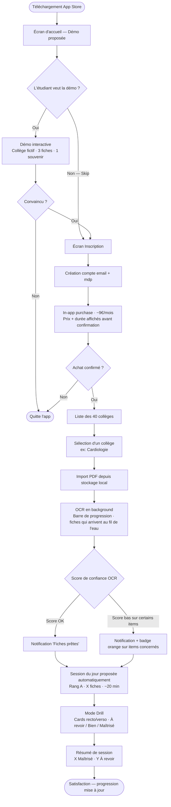
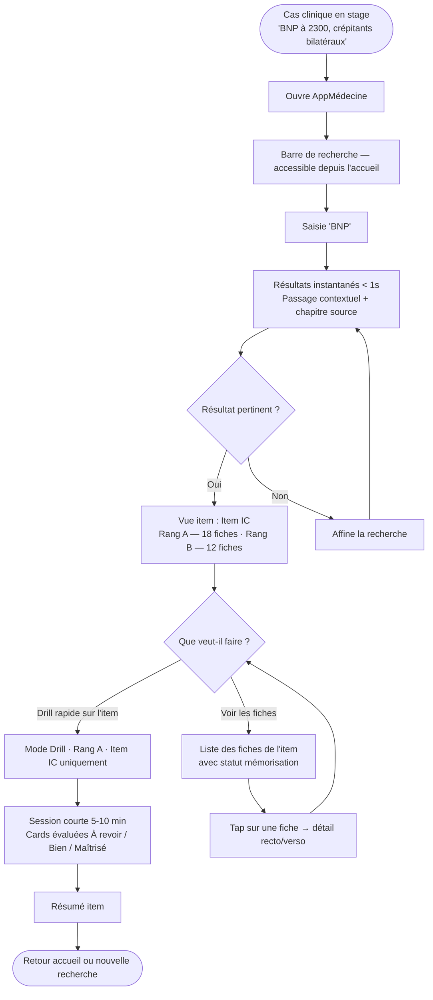
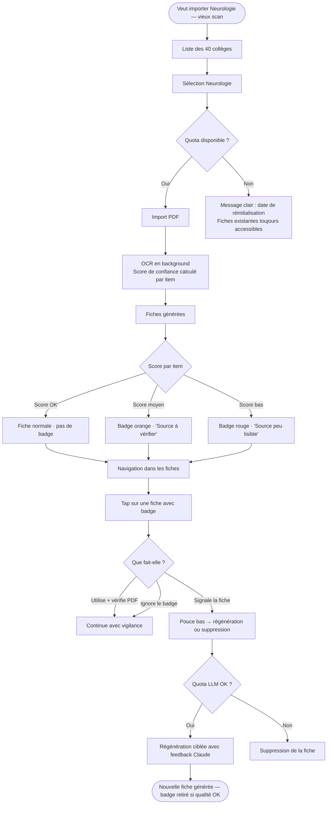
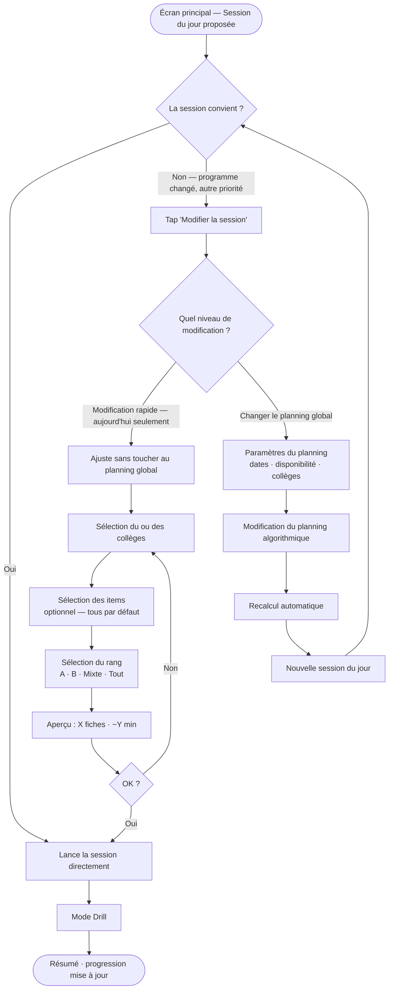
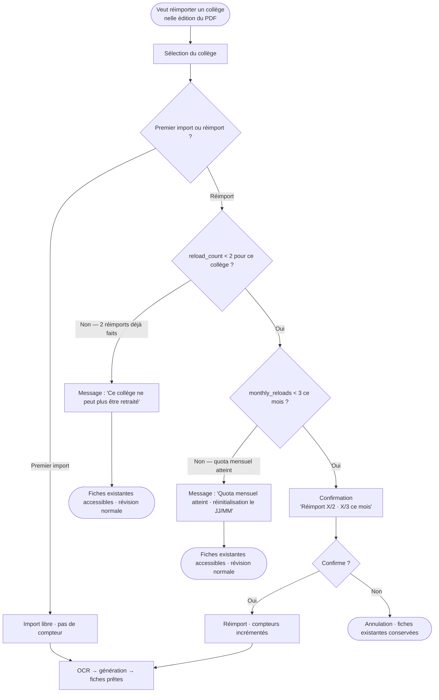

# UX Design Specification AppMédecine

**Auteur :** Lesurmatthis
**Date :** 2026-04-26

---

## Executive Summary

### Vision Projet

AppMédecine résout un problème structurel du cursus médical français : chaque faculté a son propre ordre d'enseignement, ses propres collèges, son propre calendrier d'examens. Aucun outil de révision existant ne s'y adapte. L'application permet à chaque étudiant d'importer les PDFs de *ses* collèges médicaux, de générer automatiquement des fiches de révision par item et par rang (A/B/C) via l'API Claude, et d'organiser sa révision selon *son* cursus — pas un programme universel imposé.

Le second axe de valeur connecte l'apprentissage théorique à l'expérience clinique : depuis la recherche, l'étudiant retrouve en secondes l'item correspondant à un cas vu en stage et lance une révision immédiate. Ce lien — stage clinique → révision théorique contextualisée — est impossible à reproduire par des decks partagés.

### Utilisateurs Cibles

| Persona | Contexte | Besoin UX principal |
|---|---|---|
| **Léa** (4e année, révision) | Exam dans 3 semaines | Importer vite, réviser par rang sans friction |
| **Tom** (5e année, stage) | Entre deux visites, cas clinique en tête | Retrouver un item en 2 secondes depuis la search |
| **Camille** (PDF dégradé) | Vieux scan de mauvaise qualité | Savoir quelles fiches sont fiables ou non |
| **Lesurmatthis** (opérateur) | Surveillance du backend | Monitorer et ajuster sans déploiement |
| **Maxime** (usage abusif) | Tente de spammer le retraitement | Blocage gracieux, fiches existantes intactes |

### Défis UX Clés

1. **L'attente OCR (jusqu'à 4h)** — transformer ce temps mort en moment de confiance plutôt que de frustration
2. **Onboarding → paywall** — la démo interactive doit faire comprendre la valeur *avant* l'inscription, sans jamais bloquer
3. **Complexité technique masquée** — pipeline OCR → backend → Claude → fiches doit paraître fluide et simple
4. **Transparence qualité** — le badge OCR dégradé (Camille) doit alerter sans anxiété excessive

### Opportunités UX Différenciantes

1. **Mode Stage** — le lien "cas clinique vu → recherche → révision immédiate" est unique sur ce marché et peut être une entrée UX signature
2. **Planning personnel** — visualisation de la progression par rapport au cursus réel de l'étudiant, pas un benchmark universel
3. **First-run experience** — la démo avec le faux collège "Cardiologie Exemple" montre la valeur sans friction ni inscription

---

## Expérience Cœur

### L'Expérience Définissante

La boucle principale d'AppMédecine est la **session de révision quotidienne** (Mode Drill) — 60% de l'usage. L'étudiant ouvre l'app, voit ce qu'il a à faire aujourd'hui, et révise. Pas de paramétrage, pas de décision à prendre.

La **recherche d'item** est le second axe fort (40%) — point d'entrée depuis un cas clinique ou une notion précise, avec accès immédiat aux fiches correspondantes.

### Stratégie Plateforme

- iOS + iPadOS Phase 1, navigation 100% tactile
- Offline pour tout ce qui est révision (fiches locales, Mode Drill)
- Connexion requise uniquement pour import PDF, génération et search full-text

### Interactions Sans Friction

- **Lancer une session** : un tap depuis l'écran d'accueil — la session du jour est déjà calculée, pas de choix à faire
- **Trouver un item** : recherche instantanée (< 1s), résultat direct avec passage contextuel
- **Savoir où en est l'OCR** : statut visible passivement, jamais à aller chercher
- **Gestion du calendrier** : le planning se met à jour automatiquement quand une session est marquée faite ou décalée — l'étudiant n'a pas à recalculer

### Ce qui se passe automatiquement

- Synchronisation locale des fiches après génération
- Reprise de l'OCR si interrompu en background
- Calcul et recalcul du planning (local, algorithmique, priorisé Rang A→B→C)
- Mise à jour de la progression après chaque session

### Moments de Bascule Critiques

**Le moment signature :** L'étudiant ouvre une fiche ou un item et voit *instantanément* son niveau actuel (À revoir / Bien / Maîtrisé) et combien de fiches il reste — il sait en un coup d'œil où il en est sur cette notion. C'est le moment où il réalise que l'app suit *sa* progression, pas un programme générique.

**Les make-or-break :**
- Premier import réussi → fiches prêtes → première session lancée (Léa)
- Search → item retrouvé en secondes → session lancée depuis le résultat (Tom)

### Principes d'Expérience

1. **"Où j'en suis" toujours visible** — la progression par item/rang doit être accessible d'un regard, jamais enfouie
2. **Zéro décision pour réviser** — la session du jour est proposée, pas construite par l'utilisateur
3. **Le pipeline est invisible** — OCR, backend, Claude : l'étudiant voit des fiches, pas de la technique
4. **La liberté sans complexité** — pas d'ordre imposé, mais pas de vide non plus : l'algo guide sans contraindre

---

## Réponse Émotionnelle Désirée

### Objectifs Émotionnels Principaux

L'émotion cible d'AppMédecine est la **satisfaction d'un apprentissage pertinent** — l'étudiant ressent qu'il a travaillé ce qui compte vraiment, dans l'ordre qui lui correspond. Combinée au sentiment d'être **en contrôle** de ses révisions, pas submergé par elles.

### Parcours Émotionnel

| Moment | Émotion cible | Implication UX |
|---|---|---|
| Première ouverture (démo) | **Wow** — propre, efficace, immédiatement lisible | Design soigné dès le premier écran, démo qui montre la valeur sans effort |
| Pendant l'attente OCR | **Impatience productive** — les fiches arrivent au fil de l'eau, l'étudiant peut déjà commencer | Affichage progressif des fiches au fur et à mesure de la génération, pas d'écran de blocage |
| Quand les fiches arrivent | **Surprise de la pertinence** — "c'est exactement ça" | Qualité visible dès la première fiche : formulation claire, rang bien identifié |
| En pleine session de révision | **En contrôle** — je sais où j'en suis, je pilote | Progression visible, niveau par fiche toujours affiché, pas de surprise |
| Quand quelque chose se passe mal | **Rassuré** — rien n'est perdu, c'est géré | Messages d'erreur explicatifs, fiches existantes toujours accessibles, quota affiché clairement |

### Micro-émotions Clés

- **Confiance** dans la qualité des fiches → badges OCR clairs, pas alarmistes
- **Clarté** sur quoi faire ensuite → session du jour toujours proposée
- **Progression tangible** → l'étudiant voit ses "Maîtrisé" augmenter au fil du temps

### Émotions à Éviter Absolument

| Émotion négative | Risque | Mitigation |
|---|---|---|
| **Anxiété** | "Est-ce que mes fiches sont bonnes ?" | Badge OCR discret mais lisible, option de vérifier sans alarmisme |
| **Confusion** | "Je ne sais pas quoi faire maintenant" | Session du jour toujours visible sur l'écran principal |
| **Culpabilité** | "Je suis en retard sur mon planning" | Décalage de session sans pénalité, ton neutre dans les rappels |

### Principes de Design Émotionnel

1. **Progressif, jamais bloquant** — les fiches qui arrivent au fil de l'eau pendant l'OCR transforment l'attente en anticipation
2. **Rassurant par défaut** — tout message d'état ou d'erreur doit d'abord dire "tes données sont en sécurité"
3. **La pertinence comme déclencheur de confiance** — la première fiche vue doit être suffisamment bonne pour que l'étudiant ne remette pas en question le reste

---

## Analyse UX & Inspiration

### Analyse des Produits Inspirants

**Anki**
Ce qui marche : liberté totale sur le contenu, cards partagées par la communauté, spaced repetition éprouvé.
Ce qui bloque : interface vieillissante, configuration initiale complexe (des tutoriels entiers existent pour l'installer correctement — signe que l'outil n'est pas intuitif), aucune notion de Rang A/B/C, planning entièrement à la charge de l'étudiant, maintenance continue des decks (mises à jour manuelles, surveillance régulière).

**Notion**
Ce qui marche : liberté d'organisation des données, sentiment que l'outil s'adapte à soi et non l'inverse.

### Patterns UX Transférables

**Navigation & structure**
- La liberté de contenu d'Anki → AppMédecine : l'étudiant choisit ses collèges dans l'ordre de son cursus, rien n'est imposé
- La flexibilité de Notion → planning configurable selon ses disponibilités réelles, pas un programme universel

**Interactions**
- Le spaced repetition à 3 niveaux d'Anki (À revoir / Bien / Maîtrisé) : conserver ce modèle mental que les étudiants connaissent déjà
- La progression tangible (Anki, Notion) : rendre visible l'avancement par collège et par rang

**Ce qu'AppMédecine fait mieux par conception**
- Rang A/B/C natif — jamais à la charge de l'étudiant
- Planning algorithmique proposé automatiquement — pas à construire manuellement
- Fiches générées depuis le PDF officiel — aucune maintenance, aucune mise à jour à surveiller

### Anti-Patterns à Éviter Absolument

| Anti-pattern (Anki) | Impact | Réponse AppMédecine |
|---|---|---|
| Interface vieillissante, austère | Casse l'émotion "wow" à la première ouverture | Design soigné, moderne, dès le premier écran |
| Configuration initiale complexe | Abandon avant de commencer | Démo interactive sans installation, onboarding fluide |
| Pas de rang A/B/C | L'étudiant doit tout organiser lui-même | Rang natif sur chaque fiche, filtrable |
| Planning à la charge de l'étudiant | Charge cognitive, culpabilité de mal planifier | Planning algorithmique proposé par défaut |
| Maintenance des decks (MAJ manuelles) | Friction récurrente, découragement | Fiches regénérées depuis le PDF source, pas de deck à maintenir |

### Stratégie d'Inspiration

**Adopter :** le modèle mental du spaced repetition À revoir / Bien / Maîtrisé — les étudiants le connaissent déjà via Anki, inutile de réinventer.

**Adapter :** la liberté de contenu d'Anki → dans AppMédecine, cette liberté s'exprime par le choix des collèges et l'ordre de révision, mais sans la charge de construction et maintenance des decks.

**Éviter :** tout ce qui ressemble à une "configuration" — AppMédecine doit être opérationnel dès le premier import, sans tutoriel externe nécessaire.

---

## Fondation du Design System

### Choix : shadcn_ui + flutter_animate

**Package principal :** `shadcn_ui` (Flutter port de shadcn/ui) — look sobre, propre, très pro, entièrement themeable.
**Animations :** `flutter_animate` — animations chainables ultra-simples à scripter.

### Rationale

- **shadcn_ui** correspond exactement à l'objectif "wow, clean, pro" sans le look Material/Google
- Entièrement themeable : notre palette verte + Inter s'intègre nativement
- Liberté totale sur les composants — shadcn_ui fournit les primitives, pas un style imposé
- **flutter_animate** couvre tous les besoins d'animation du Mode Drill (retournement card, transitions, évaluation) avec une API simple
- Compatible iOS/iPadOS Phase 1 et Android Phase 2 sans double stack

### Approche d'Implémentation

- `shadcn_ui` comme fondation de l'UI — composants, tokens, thème
- `flutter_animate` pour toutes les animations et micro-interactions
- Widgets Cupertino uniquement pour les interactions iOS-spécifiques natives (ex : file picker, date picker)
- Composants custom AppMédecine (FlashCard, SessionHeroCard…) construits par-dessus shadcn_ui

### Stratégie de Personnalisation

- **Couleurs** : palette vert émeraude `#1B6B3A` appliquée dans le thème shadcn_ui, accessible WCAG AA
- **Typographie** : Inter (déjà le défaut shadcn_ui)
- **Formes** : border-radius modérés — cohérents avec l'esthétique shadcn
- **Animations clés** : retournement FlashCard · entrée/sortie cards drill · transitions d'écran · feedback évaluation

---

## Expérience Définissante

### L'Interaction Signature

> "J'ouvre l'app, ma session du jour m'attend — je révise, je vois instantanément où j'en suis sur chaque notion."

### Modèle Mental Utilisateur

Les étudiants arrivent avec le modèle Anki : cards recto/verso, 3 niveaux (À revoir / Bien / Maîtrisé), spaced repetition. Ce modèle est déjà installé — AppMédecine l'améliore sur deux points sans le réinventer :
- Le rang A/B/C est natif (dans Anki : à construire manuellement)
- La session est proposée par l'app (dans Anki : à planifier soi-même)

### Critères de Succès de l'Expérience Cœur

- L'étudiant lance sa session en un tap depuis l'écran principal
- Chaque card est évaluée en moins de 3 secondes (geste simple, familier)
- En fin de session, la progression par item est mise à jour et visible immédiatement
- L'étudiant sait sans chercher combien de fiches restent "À revoir" sur chaque rang

### Patterns Établis vs. Nouveaux

**Établis (hérités d'Anki — adopter sans friction) :**
- Cards recto/verso avec retournement
- 3 niveaux de mémorisation
- Spaced repetition (les "À revoir" reviennent plus fréquemment)

**Nouveaux (propres à AppMédecine — mettre en avant) :**
- Session du jour pré-calculée par l'algo, proposée dès l'ouverture
- Rang A/B/C natif visible à tout moment sur chaque fiche
- Progression par item/rang accessible d'un regard, sans navigation

### Mécanique de l'Expérience

| Étape | Ce qui se passe | Signal UX |
|---|---|---|
| **Initiation** | L'étudiant ouvre l'app — la session du jour est affichée sur l'écran principal | "X fiches · Rang A · Cardiologie" — un tap pour commencer |
| **Interaction** | Card présentée recto. L'étudiant réfléchit, retourne. Évalue : À revoir / Bien / Maîtrisé | Swipe ou tap — geste simple et familier |
| **Feedback** | Après chaque card : la progression de la session avance | Barre de progression en haut, récap en fin de session |
| **Complétion** | Session terminée. Progression par item mise à jour — les rangs changent visuellement | Moment de satisfaction visible : les compteurs "Maîtrisé" progressent |

---

## Fondation Visuelle

### Système de Couleurs

Base Material 3 — palette verte profonde et moderne, sans le cliché "vert clinique hôpital".

| Rôle | Couleur | Usage |
|---|---|---|
| **Primary** | Vert émeraude profond `#1B6B3A` | Actions principales, boutons, liens |
| **Primary container** | Vert clair `#B7F2C8` | Fonds de cards, états sélectionnés |
| **Secondary** | Teal `#3D6B5E` | Éléments secondaires, tags rang |
| **Surface** | Blanc cassé `#F8FAF9` | Fonds d'écran, cards |
| **On surface** | Gris foncé `#1A1C1A` | Texte principal |
| **Error** | Rouge sobre `#BA1A1A` | Erreurs, badge OCR dégradé |
| **Warning** | Amber `#F0A500` | Badge OCR moyen |

**Couleurs sémantiques pour les rangs :**
- Rang A → `#1B6B3A` (primary vert) — priorité maximale
- Rang B → `#3D6B5E` (teal) — secondaire
- Rang C → gris neutre — optionnel

**Accessibilité :** tous les couples texte/fond visent un ratio ≥ 4.5:1 (WCAG AA).

### Système Typographique — Inter

Police unique : **Inter** (Google Fonts, open source, intégrée Flutter via `google_fonts`).

| Style | Taille | Graisse | Usage |
|---|---|---|---|
| `displayMedium` | 28sp | 700 | Titres écrans principaux |
| `headlineMedium` | 22sp | 600 | Titres de sections, nom collège |
| `titleMedium` | 16sp | 600 | Titres de cards, items |
| `bodyLarge` | 16sp | 400 | Contenu des fiches |
| `bodyMedium` | 14sp | 400 | Texte secondaire, métadonnées |
| `labelMedium` | 12sp | 500 | Tags rang A/B/C, badges |

### Espacements & Layout

Base **8px** — système Material 3 standard.

| Élément | Valeur |
|---|---|
| Margin écran | 16px |
| Padding interne card | 16px |
| Espacement entre cards | 8px |
| Espacement entre sections | 24px |
| Border radius cards | 12px |
| Border radius boutons | 8px |

Layout : colonne unique sur iPhone, grille 2 colonnes sur iPad pour la liste des collèges.

### Accessibilité

- Contraste texte/fond ≥ 4.5:1 sur toutes les surfaces
- Taille minimale de tap target : 44×44px (Apple HIG)
- Support du Dynamic Type iOS
- Dark mode : prévu dans la stratégie Material 3, à implémenter post-MVP

---

## Direction de Design

### Décision

La direction visuelle finale sera conçue dans un outil de design dédié (Figma ou équivalent) en s'appuyant sur les tokens établis à l'étape 8. Six directions ont été explorées via des maquettes HTML — aucune n'a été arrêtée définitivement à ce stade.

### Tokens disponibles pour l'outil de design

- **Palette** : vert émeraude `#1B6B3A`, teal `#3D6B5E`, surface `#F8FAF9`, rangs A/B/C
- **Typographie** : Inter, 6 niveaux de 28sp à 12sp
- **Espacement** : base 8px, marges 16px, border-radius cards 12px
- **Système** : Material 3 + thème custom Flutter

### Prochaine étape visuelle

Conception dans Figma en parallèle du workflow UX. Le document de spec UX fournit les contraintes fonctionnelles et les principes d'expérience — le rendu visuel final est délégué à l'outil de design.

---

## User Journey Flows

### Flow 1 — Léa : Onboarding → Première Session

Parcours de conversion complet : du téléchargement à la première session de révision.



**Points de friction à éliminer :**
- La démo fonctionne sans compte (exigence App Store)
- L'attente OCR ne bloque jamais un écran vide — les fiches arrivent progressivement
- Le paywall n'apparaît qu'après que la démo a montré la valeur

---

### Flow 2 — Tom : Search → Item → Drill (Mode Stage)

Point d'entrée depuis un cas clinique vu en stage.



**Point clé :** La search est accessible en 1 tap depuis n'importe quel écran.

---

### Flow 3 — Camille : Import PDF Dégradé → Badge OCR

Transparence sur la qualité des fiches générées depuis un scan de mauvaise qualité.



**Point clé :** Le badge informe sans alarmer — ton "vérifie si tu veux", pas "fiche dangereuse".

---

### Flow 4 — Personnalisation de la Session du Jour

Quand la session proposée ne correspond pas au programme actuel ou à la priorité du moment.



**Points UX clés :**
- "Modifier" visible dès l'écran principal — la session proposée n'est pas un fait accompli
- Modification rapide (aujourd'hui) vs modification du planning (long terme) : deux chemins distincts
- Aperçu du nombre de fiches avant de lancer

---

### Flow 5 — Réimport avec Quota Atteint (Maxime)

Blocage gracieux quand l'étudiant tente de dépasser les limites anti-spam.



**Points UX clés :**
- Le compteur est affiché *avant* confirmation — jamais de surprise après coup
- Blocage collège (définitif) vs blocage mensuel (temporaire + date) : messages distincts
- Dans tous les cas : les fiches existantes restent intactes — l'étudiant peut toujours réviser

---

### Patterns Communs

**Navigation :**
- Search accessible depuis tout écran en 1 tap
- Retour toujours possible sans perdre le contexte

**Feedback :**
- Toute action longue (OCR, génération) a un indicateur de progression visible
- Les fiches arrivent progressivement — jamais d'écran de blocage

**Erreurs & limites :**
- Les blocages donnent toujours une date ou une action alternative
- Les fiches existantes restent accessibles quelle que soit l'erreur
- Ton rassurant systématique : "tes données sont là" avant d'expliquer la limite

---

## Stratégie de Composants

### Composants shadcn_ui Utilisables Tels Quels

| Composant shadcn_ui | Usage dans AppMédecine |
|---|---|
| `ShadNavigationBar` | Bottom nav (Accueil · Collèges · Search · Profil) |
| `ShadInput` | Barre de recherche full-text |
| `ShadCard` | Conteneur générique (collèges, résultats search) |
| `ShadButton` (primary / outline / ghost) | CTA principaux et secondaires |
| `ShadProgress` | Progression OCR, progression de session |
| `ShadBadge` | Tags rang A/B/C, compteurs navigation |
| `ShadSelect` / `ShadPopover` | Filtres rang, sélection items |
| `ShadToast` | Notifications légères (remplace SnackBar) |
| `ShadDialog` / `ShadAlertDialog` | Confirmations (réimport, suppression) |
| `ShadSkeleton` | États de chargement (plus élégant que CircularProgressIndicator) |

**Animations (flutter_animate) :**
- Retournement `FlashCard` : `.flip()` + `.fade()`
- Card évaluée "Maîtrisé" → disparition vers le haut : `.slideY().fade()`
- Card évaluée "À revoir" → disparition vers le bas : `.slideY(begin: 0, end: 1).fade()`
- Entrée des fiches générées progressivement : `.fadeIn().slideX()`
- Transitions d'écran : `.animate().fade()`

### Composants Custom à Développer

**`FlashCard`** — composant cœur du Mode Drill
- Recto : question / verso : réponse, animation de retournement
- États : recto affiché · verso affiché · évalué
- Variants : flashcard classique · définition (terme médical → définition)
- Badge rang A/B/C en haut à droite · badge OCR si qualité dégradée

**`DrillEvaluationBar`** — barre d'évaluation sous la card
- 3 boutons : À revoir (rouge) · Bien (amber) · Maîtrisé (vert)
- Apparaît uniquement après retournement de la card
- Feedback haptique au tap

**`SessionHeroCard`** — carte "session du jour" en hero sur l'accueil
- Affiche : collège · rang · nombre de fiches · durée estimée
- CTA principal "Commencer" · lien secondaire "Modifier"
- États : session disponible · aucune session planifiée · génération en cours

**`CollegeProgressTile`** — ligne de collège avec progression
- Icône spécialité · nom · barre de progression · pourcentage
- Badges rangs disponibles (A/B/C)
- États : importé avec fiches · OCR en cours · pas encore importé

**`OcrConfidenceBadge`** — badge de qualité OCR
- Variants : orange "À vérifier" · rouge "Source peu lisible"
- Discret mais visible — jamais alarmiste
- Accessible : icône + texte (pas couleur seule)

**`ItemProgressBar`** — répartition À revoir / Bien / Maîtrisé d'un item
- Barre segmentée 3 couleurs (rouge · amber · vert)
- Chiffres exacts affichés · utilisé dans la vue item et le tableau de progression

**`SearchResultTile`** — résultat de recherche full-text
- Terme recherché surligné dans le passage contextuel
- Chapitre source + rang de l'item
- CTA "Réviser cet item" direct depuis le résultat

### Roadmap d'Implémentation

**Phase 1 — Bloquants MVP :**
- `FlashCard` + `DrillEvaluationBar` — sans eux, le Mode Drill n'existe pas
- `SessionHeroCard` — écran principal
- `OcrConfidenceBadge` — requis pour la transparence qualité OCR

**Phase 2 — Complètent l'expérience :**
- `CollegeProgressTile` — liste des collèges
- `ItemProgressBar` — tableau de progression
- `SearchResultTile` — mode stage / flow Tom

---

## Patterns UX de Cohérence

### Hiérarchie des Boutons

| Niveau | Style | Usage |
|---|---|---|
| **Primaire** | `ShadButton` filled vert | Action principale de l'écran — "Commencer", "Confirmer l'achat", "Importer" |
| **Secondaire** | `ShadButton` outline | Action alternative — "Modifier", "Voir les fiches", "Plus tard" |
| **Tertiaire** | `ShadButton` ghost | Actions légères — "Skip la démo", "Annuler", liens |
| **Destructif** | `ShadButton` destructive | Suppression définitive — "Supprimer la fiche", "Supprimer le compte" |

Règle : **un seul bouton primaire par écran**. Le CTA "Commencer la session" est toujours le plus visible.

### Feedback Patterns

| Situation | Pattern | Ton |
|---|---|---|
| Action réussie | `ShadToast` vert · 3s | Positif, bref — "Fiche signalée" |
| Erreur récupérable | `ShadToast` avec action "Réessayer" | Neutre, actionnable |
| Blocage quota | `ShadAlertDialog` avec date de réinitialisation | Rassurant — "tes fiches sont là" en premier |
| OCR en cours | `ShadProgress` + fiches progressives via `flutter_animate` | Impatience productive — jamais un écran vide |
| OCR qualité basse | `OcrConfidenceBadge` sur la fiche concernée | Informatif, pas alarmiste |
| Génération terminée | Notification push + badge sur l'icône collège | Satisfaction — "tes fiches sont prêtes" |

### États Vides

Chaque état vide explique **pourquoi** et propose **quoi faire** :

| Écran | État vide | Message + action |
|---|---|---|
| Accueil — aucun collège | Aucun collège importé | "Importe ton premier collège pour commencer →" |
| Accueil — génération en cours | OCR en background | `ShadProgress` + "Tes fiches arrivent…" |
| Liste collèges | Aucun importé | "Sélectionne un collège dans les 40 disponibles →" |
| Résultats search | Aucun résultat | "Aucun résultat pour '[terme]' — essaie un autre mot" |
| Mode Drill | Session terminée | Résumé animé + "Prochaine session : [date]" |

### Navigation Patterns

- **Bottom nav** : 4 tabs fixes — Accueil · Collèges · Recherche · Profil
- **Search** : accessible depuis le tab dédié ET via barre raccourci sur l'accueil
- **Retour** : geste iOS natif (swipe left) — pas de bouton retour custom
- **Navigation contextuelle** : search → vue item → drill, titre d'écran comme breadcrumb implicite
- **Drill** : modale plein écran — bottom nav masquée pendant la session

### Patterns Spécifiques AppMédecine

**Évaluation de fiche (DrillEvaluationBar) :**
- Cachée jusqu'au retournement — impossible d'évaluer sans avoir vu la réponse
- "Maîtrisé" → card animée vers le haut et disparaît (`flutter_animate` `.slideY().fade()`)
- "À revoir" → card animée vers le bas, reviendra plus tard dans la session

**Messages de quota :**
- Structure systématique : 1/ "Tes fiches existantes sont toujours accessibles" · 2/ Explication du blocage · 3/ Date de réinitialisation
- Jamais "bloqué" ou "interdit" — toujours "limite atteinte" + solution

**Badge OCR :**
- Visible en mode drill ET dans la liste des fiches
- Tap sur le badge → `ShadPopover` court + lien "Voir dans le PDF"
- Disparaît après régénération réussie

---

## Responsive Design & Accessibilité

### Stratégie Responsive

**iPhone (cible principale Phase 1) :**
- Colonne unique, bottom nav fixe, contenu scrollable vertical
- FlashCard plein écran en mode drill

**iPad (cible secondaire Phase 1) :**
- Liste des 40 collèges → grille 2 colonnes
- FlashCard plus grande, même interaction
- Bottom nav conservée — pas de split view (complexité inutile pour le MVP)

**Android (Phase 2) :**
- Même codebase Flutter — adaptations minimales
- Remplacer les pickers Cupertino par leurs équivalents Android
- Tester le thème shadcn_ui sur différentes densités d'écran

### Breakpoint Flutter

Un seul breakpoint à **600px** via `LayoutBuilder` :

| Seuil | Appareil | Adaptation |
|---|---|---|
| `< 600px` | iPhone | Layout standard — colonne unique |
| `≥ 600px` | iPad | Grille 2 colonnes sur la liste des collèges |

### Stratégie d'Accessibilité — WCAG AA

| Exigence | Implémentation Flutter |
|---|---|
| Contraste texte ≥ 4.5:1 | Palette verte vérifiée sur surfaces claires et sombres |
| Tap target ≥ 44×44px | Tous les boutons, badges OCR, boutons d'évaluation |
| VoiceOver (iOS) | Semantic labels sur tous les composants custom |
| Dynamic Type | `MediaQuery.textScaleFactor` respecté sur toutes les typos |
| Non dépendance à la couleur seule | `OcrConfidenceBadge` : icône + texte, pas couleur seule |
| Focus navigation | Ordre de focus logique dans les formulaires |

### Hors scope Phase 1

- Dark mode automatique (post-MVP)
- Support VoiceOver complet sur animations `flutter_animate`
- Tests utilisateurs en situation de handicap

### Directives Développeur

```dart
// Breakpoint iPad
LayoutBuilder(builder: (context, constraints) {
  final isTablet = constraints.maxWidth >= 600;
  return isTablet ? CollegeGrid2Columns() : CollegeListView();
})

// Semantic label FlashCard
Semantics(
  label: 'Flashcard Rang A — $question',
  hint: 'Double tap pour retourner',
  child: FlashCard(...),
)

// Tap target minimum
SizedBox(
  width: 44, height: 44,
  child: OcrConfidenceBadge(...),
)
```

---

## Écrans

Maquettes visuelles issues de Google Stitch. Fichiers HTML/Tailwind dans `_bmad-output/planning-artifacts/screens/`. Ces fichiers servent de **référence visuelle** pour les développeurs Flutter — ils ne sont pas du code Flutter réutilisable directement.

### Accueil (`screens/home.html`)

**Objectif :** Point d'entrée quotidien, lancer la session de révision sans friction.

| Zone | Composant | Notes UX |
|---|---|---|
| Header | TopAppBar fixe | Avatar profil à gauche, logo centré, cloche notifications à droite |
| Recherche | SearchBar | Placeholder : "Rechercher un item, un signe, une dose..." — accès rapide à la search globale |
| Hero | SessionHeroCard | Titre + bouton "Modifier" (icône `edit`, inline en haut à droite), collège + rang + durée + CTA "Commencer" |
| Corps | CollegeRecentGrid | 2 cartes collège (Neurologie 68%, Néphrologie 32%) avec barre de progression |
| Navigation | BottomNavBar | 4 onglets : Home (actif), Colleges, Search, Profile |

**Décisions UX :**
- Le bouton "Modifier" est désormais inline dans le header de la SessionHeroCard (icône `edit` + texte), visible directement — supprime le lien discret `hidden sm:block` de la v1.
- Fond légèrement coloré (blob `secondary-fixed` flou) sur la hero card pour hiérarchiser visuellement sans surcharge.
- Icône de la card passée de `local_hospital` à `menu_book` pour mieux refléter le contexte révision.

---

### Mes Collèges (`screens/colleges.html`)

**Objectif :** Vue d'ensemble de tous les collèges (importés et disponibles), gestion (mise à jour, suppression, import).

| Zone | Composant | Notes UX |
|---|---|---|
| Header | TopAppBar | Avatar à gauche, "Mes Collèges" centré, icône search à droite |
| Filtres | FilterChips | Tous / Importés / Non-importés |
| Grille | CollegeCardGrid | 1 colonne mobile → 2 col md/lg |
| Carte importée | CollegeCard | Icône + nom + éditeur (ex: "CEN") + badge "Importé" + barre 4 segments (Maîtrisé/Bien/À revoir/**Non vues**) + actions "Mettre à jour" + poubelle |
| Carte non-importée | CollegeCardEmpty | Icône grisée + badge "Non-importé" + texte descriptif + CTA "Charger ce collège" |
| Navigation | BottomNavBar | Onglet "Colleges" actif |

**Décisions UX :**
- La barre segmentée passe à **4 segments** : Maîtrisé / Bien / À revoir / Non vues (gris) — donne une vision complète de l'avancement réel, pas juste de la qualité.
- Les collèges non-importés sont visibles dans la même grille (filtrables) — l'utilisateur voit ce qui lui manque et peut importer directement.
- Actions de gestion directement sur la carte (sync + delete) sans navigation vers un écran séparé.
- L'éditeur (CEN, CEP…) est affiché en sous-titre pour différencier plusieurs versions du même collège.

---

### Mode Drill (`screens/drill.html`)

**Objectif :** Révision en immersion totale, sans distraction.

| Zone | Composant | Notes UX |
|---|---|---|
| Header | DrillHeader custom | Bouton ✕ (gauche) + titre tronqué + badge Rang A (droite) — **pas de bottom nav** |
| Progression | ProgressBar linéaire | "5 / 24" fiches, barre `primary-container`, largeur dynamique (21%) |
| Corps | FlashCard | Carte centrée min-h 400px, question headline, hint "Retourner" au hover |
| Footer | TapHint | Icône `touch_app` + "Tapoter pour voir la réponse" — disparaît après le premier retournement |

**Décisions UX :**
- Aucun bottom nav en mode drill → immersion maximale, sortie uniquement via ✕ explicite.
- L'hint de retournement est en `opacity-0 group-hover:opacity-100` sur desktop, toujours visible sur mobile via le footer.
- Le badge rang est `shrink-0` pour ne jamais être tronqué même si le titre est long.

---

### Recherche (`screens/search.html`)

**Objectif :** Retrouver un item depuis un terme clinique (symptôme, biomarqueur, médicament) en quelques secondes.

| Zone | Composant | Notes UX |
|---|---|---|
| Header | Même TopAppBar | |
| Recherche | SearchBar active | Valeur pré-remplie "BNP", bordure `primary`, bouton ✕ pour effacer |
| Compteur | ResultCount | "2 items trouvés" + lien "Filtrer" |
| Résultat 1 | ResultCard (Rang A) | Titre + badge rang + provenance (Item 232 · Cardiologie) + extrait contextuel avec `<mark>` + CTA "Réviser l'item" |
| Résultat 2 | ResultCard (Rang B) | Même structure, badge teal secondaire, pas de CTA secondaire |
| Navigation | BottomNavBar | Onglet "Search" actif |

**Décisions UX :**
- L'extrait contextuel avec le terme surligné (`mark` vert clair `#bbeddc`) permet à l'utilisateur de valider la pertinence sans ouvrir l'item.
- Le CTA "Réviser l'item" est présent uniquement sur le premier résultat (Rang A) — les résultats de rang inférieur invitent à l'exploration plutôt qu'à l'action immédiate.
- La bordure gauche colorée sur l'extrait (vert pour Rang A, teal pour Rang B) code le rang sans répéter le badge.
- Champ de recherche toujours visible et focusé en haut — tap sur fond clavier reste accessible.

---

### Drill verso (`screens/drill-verso.html`)

**Objectif :** Afficher la réponse et recueillir l'auto-évaluation de l'étudiant.

| Zone | Composant | Notes UX |
|---|---|---|
| Header | DrillHeader | Identique au recto — ✕, titre, badge rang, compteur 5/24 |
| Barre | ProgressBar | Même barre linéaire (20.83%) — continuité visuelle recto/verso |
| Card haut | QuestionReminder | Bandeau `surface-container-low` avec la question en rappel (tone atténué) |
| Card corps | AnswerList | 4 items avec icône `check_circle` filled vert primary |
| Card bas | AssessmentButtons | 3 boutons empilés : "À revoir" (bordure error), "Bien" (bordure secondary), "Maîtrisé" (filled primary) |

**Décisions UX :**
- La question est rappelée en haut de carte (bandeau grisé) pour que l'étudiant puisse évaluer sans avoir à mémoriser — réduit la charge cognitive.
- Les 3 boutons sont empilés verticalement (pleine largeur) et non côte-à-côte — plus facile à tapper sur mobile, moins de risque de mauvais tap.
- Ordre délibéré bas → haut en termes de valeur : "À revoir" en haut (rouge), "Maîtrisé" en bas (vert) — le vert en dernier ancre positivement même si on sélectionne À revoir.
- Aucun bottom nav — immersion drill maintenue jusqu'à l'évaluation.

---

### Fin de session (`screens/session-terminee.html`)

**Objectif :** Clore la session avec un sentiment d'accomplissement et orienter vers la prochaine action.

| Zone | Composant | Notes UX |
|---|---|---|
| Hero | SuccessHeader | Icône `task_alt` filled dans cercle `primary-fixed`, titre "Session terminée !", sous-titre item |
| Visuel | MasteryCircle | Donut SVG 85% maîtrise + chiffre centré — lecture immédiate du score global |
| Stats | StatsBento | 3 cartes : Maîtrisé (vert), Bien (teal), À revoir (rouge) avec compte et couleur codée |
| Analyse | AnalysisTags | 2 sections : "Points forts" (trending_up vert) + "À consolider" (trending_down rouge) avec chips thématiques |
| Actions | CTAStack | "Recommencer les erreurs" (filled primary) + "Retour à l'accueil" (outlined) |

**Décisions UX :**
- Le donut à 85% en premier plan crée un moment de satisfaction avant les détails — reward loop.
- Les chips d'analyse (thèmes forts/faibles) donnent un feedback qualitatif, pas juste quantitatif — encourage la méta-cognition.
- "Recommencer les erreurs" est primary car c'est l'action la plus utile pédagogiquement ; "Retour accueil" en secondary.
- Pas de bottom nav ni header — écran de transition plein focus.

---

### Détail collège (`screens/college-detail.html`)

**Objectif :** Lister les items d'une spécialité avec leur niveau de maîtrise, permettre l'accès à un item.

**Navigation :** Mes Collèges → tap sur une carte collège → Détail Collège

| Zone | Composant | Notes UX |
|---|---|---|
| Header | TopAppBar | Flèche retour + nom collège en majuscules + cloche notifications |
| Résumé | ProgressSummaryCard | "Progression Globale" + QCM complétés + % affiché en display + barre linéaire |
| Filtres | FilterChips | Tous (actif) / Rang A / Rang B / Rang C — scrollable horizontal |
| Liste | ItemList | Chaque item : badge rang + numéro + titre + barre de progression mini + chevron |
| Navigation | BottomNavBar | Colleges tab actif |

**Décisions UX :**
- Le résumé global en carte en haut remet en contexte la progression de toute la spécialité avant de plonger dans les items.
- Filtres par rang permettent de prioriser (Rang A d'abord pour l'examen).
- La barre de progression mini par item (max-w 120px) donne un signal visuel rapide sans surcharger la ligne.
- Hover : chevron passe en `primary-container` pour confirmer l'interactivité.

---

### Détail item (`screens/item-detail.html`)

**Objectif :** Consulter le contenu structuré d'un item et lancer le drill depuis ce contexte.

**Navigation :** Détail Collège → tap sur un item → Détail Item

| Zone | Composant | Notes UX |
|---|---|---|
| Header | ItemHeader | Flèche retour + "Item 232 · Insuffisance Cardiaque" tronqué + icône bookmark |
| Tabs | RangTabBar | Rang A (actif, primary-container) / Rang B (secondary-container) / Rang C (neutral) — sticky sous header |
| Contenu | CollapsibleSections | Sections accordéon : Définition (ouverte), Diagnostic (fermée), Traitement (fermée) |
| Aperçu | FlashcardStrip | Scroll horizontal de mini-cartes avec bordure gauche codée par rang + question tronquée |
| CTA sticky | DrillLaunchBar | Barre fixe juste au-dessus du bottom nav : "Lancer le drill · 24 fiches" pleine largeur |
| Navigation | BottomNavBar | Colleges tab actif |

**Décisions UX :**
- L'accordéon (sections fermées par défaut sauf Définition) permet de naviguer rapidement dans un item dense sans scroll infini.
- Le strip de prévisualisation des fiches donne envie de lancer le drill — aperçu des questions à venir.
- Le CTA drill est fixed juste au-dessus du bottom nav (non `bottom-0` mais `bottom-60px`) pour éviter le double overlay sur mobile.
- Le filtrage par rang via les tabs permet de réviser seulement Rang A avant un exam sans quitter l'item.

---

### Personnalisation de session (`screens/session-personnalisation.html`)

**Objectif :** Permettre à l'utilisateur de modifier les paramètres de la session du jour avant de la lancer.

**Navigation :** Accueil → tap "Modifier" sur SessionHeroCard → bottom sheet coulisse vers le haut

| Zone | Composant | Notes UX |
|---|---|---|
| Fond | DimmedOverlay | Fond `on-surface/40` — le contenu derrière reste visible mais inaccessible |
| Sheet | BottomSheet | `h-[751px]` (~85% écran), `rounded-t-xl`, shadow haut |
| Header sheet | SheetHeader | Titre "Personnaliser la session" + bouton ✕ |
| Section 1 | CollegeSelector | Liste single-select des collèges importés — sélection avec `check_circle` filled |
| Section 2 | RangChips | 3 chips multi-select : Rang A (primary), Rang B (secondary), Rang C (neutral) — hint "Sélection multiple" |
| Section 3 | QuantityStepper | Stepper – / 24 / + pour le nombre de fiches |
| Section 4 | StatusChips | Chips : Toutes (actif) / À revoir / Non vues |
| Footer sticky | SaveCTA | "Enregistrer la session →" pleine largeur, fond `primary-container` |

**Décisions UX :**
- Bottom sheet plutôt que page dédiée — l'utilisateur reste contextuellement sur l'accueil, la modification est perçue comme légère.
- Single-select pour le collège (une session = un collège) — évite la complexité d'une session multi-collège.
- Le filtre "Statut des fiches" permet de cibler uniquement les fiches à revoir ou non vues — optimise le temps de révision.
- Le CTA est sticky en bas du sheet même si le contenu défile.

---

### Import en cours (`screens/import-progress.html`)

**Objectif :** Informer l'utilisateur de l'avancement du traitement OCR + génération Claude sans anxiété.

**Navigation :** Mes Collèges → "Charger ce collège" → sélection PDF → Import en cours

| Zone | Composant | Notes UX |
|---|---|---|
| Header | AppBar | Flèche retour + titre "Import en cours" |
| Fichier | FileInfoCard | Icône PDF (error-container rouge), nom fichier, taille, badge "Traitement en cours..." |
| Stepper | ProgressStepper | 4 étapes verticales avec état : ✅ fait (primary-container) / 🔄 en cours (border + sync) / ⏳ en attente (outline-variant) |
| Étapes | — | 1. PDF reçu et validé ✅ · 2. Extraction OCR ✅ · 3. Génération Claude 🔄 (~45 min) · 4. Classement ⏳ |
| Info | InfoBanner | Fond `primary-fixed` vert clair + icône `info` — "Vous pouvez fermer l'app, vous serez notifié" |
| Footer | CloseButton | "Fermer et continuer" outlined — permet de quitter sans interrompre |

**Décisions UX :**
- Le stepper donne une transparence totale sur le pipeline technique — réduit l'anxiété de l'attente longue.
- L'estimation de temps ("~45 minutes restantes") est affichée seulement sur l'étape active — pas sur les étapes futures qui sont incertaines.
- Le banner "vous pouvez fermer l'app" est prioritaire visuellement — l'utilisateur ne doit pas rester bloqué sur cet écran.
- Pas de bottom nav — écran de progression focalisé, sortie uniquement via retour ou "Fermer".

---

### Profil (`screens/profile.html`)

**Objectif :** Gérer l'identité, suivre le quota d'import, configurer les préférences de révision.

| Zone | Composant | Notes UX |
|---|---|---|
| Header | PageHeader centré | "Profil Utilisateur" centré, pas de navigation back (onglet direct) |
| Bloc 1 | IdentityCard | Prénom (obligatoire) + Année + Faculté (facultatifs) — affichage lecture, tap pour éditer |
| Bloc 2 | SubscriptionCard | Badge "Actif" (ou warning résiliation) + barre quota `2/3 imports` + texte renouvellement |
| Bloc 3 | RevisionPrefsCard | Rangs actifs (chips A/B/C toggleables) + stepper "Fiches max" |
| Bloc 4 | NotifCard | Toggle "Notifications de rappel" |
| Bloc 5 | AppCard | Version · CGU · "Se déconnecter" (error color + `logout` icon) |
| Navigation | BottomNavBar | Onglet "Profile" actif |

**Décisions UX :**
- Pas d'avatar — l'identité médicale est définie par prénom + année + faculté, pas par une photo.
- Le bandeau de résiliation (`error-container`) n'apparaît que si l'abonnement est en cours de résiliation — sinon le badge "Actif" est discret (pas mis en avant).
- Les rangs dans les préférences (A/B/C toggleables) synchronisent les valeurs par défaut utilisées dans la personnalisation de session.
- "Se déconnecter" est en rouge avec icône `logout` — suffisamment visible sans être alarmiste.
